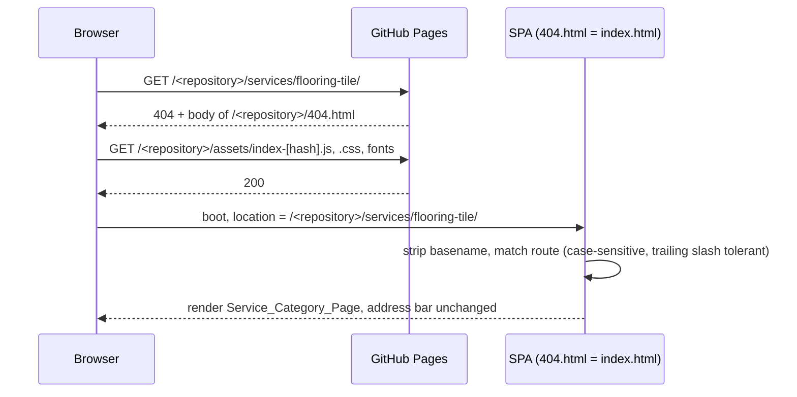
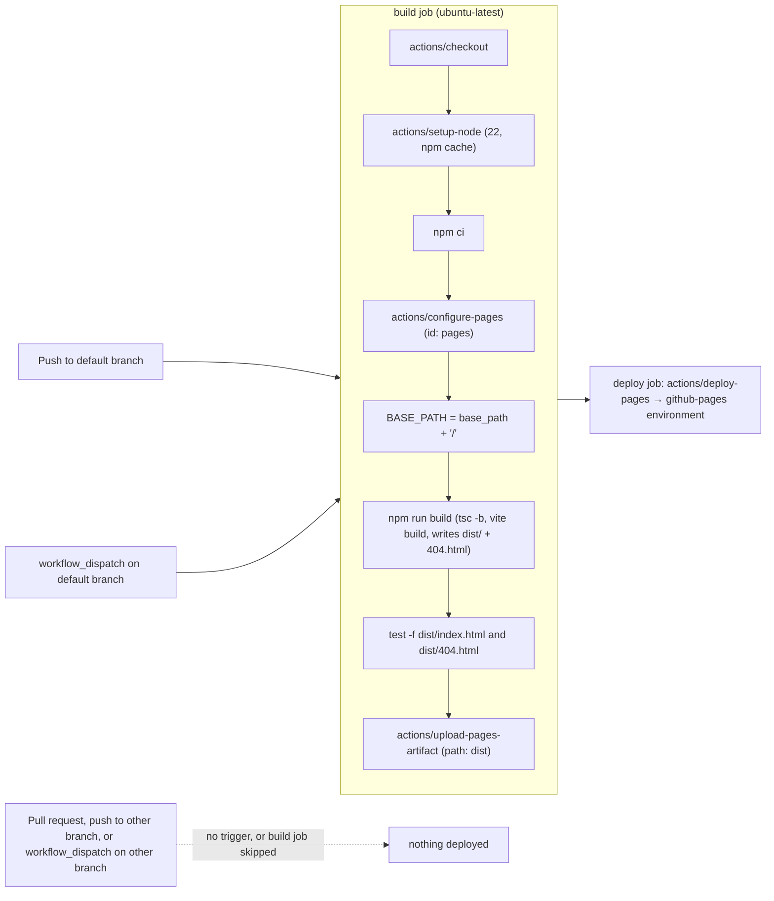
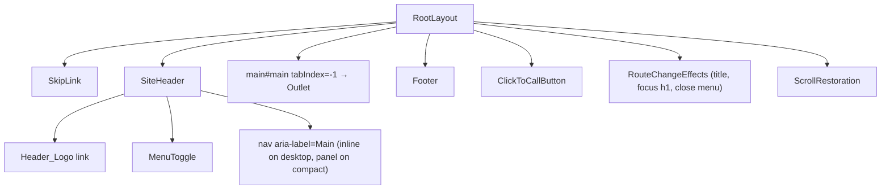

# Design Document: D&T Go Elite Concept Website

## Overview

The Website is a static, frontend-only React single-page application (SPA) for D&T Go Elite Roofing and Construction. It is built with Vite into one output directory, deployed to GitHub Pages by a GitHub Actions workflow (`.github/workflows/deploy.yml`, the Pages_Pipeline), and needs no server code at runtime. All content lives in one Content_Module, all styling flows from one set of Theme tokens, and all non-trivial behavior (slugs, filtering, rating math, form validation, viewer navigation, accordion state, city sorting, base-path handling) lives in small pure functions under `src/lib/`. React components stay thin: they read content, call those functions, and render.

### Recommended stack

| Concern | Choice | Why |
|---|---|---|
| Build tool | Vite (current major, 7.x) with `@vitejs/plugin-react` | Fast dev server, static output, `base` option handles the GitHub Pages project-site subpath `/<repository>/`. Dev and `vite preview` both fall back to `index.html` for unknown paths, which satisfies Req 1.8 and 5.4 locally. |
| Language | TypeScript (strict) | Literal-union types make the seven Service_Category names and the content shapes compile-time checked. |
| UI | React 19 | Current stable. |
| Routing | React Router 7 (`createBrowserRouter`, data mode) with `basename` | Path-based URLs, `caseSensitive` route option (Req 5.11), trailing-slash-tolerant matching (Req 5.10), `<ScrollRestoration>` (Req 5.8). |
| Styling | Plain CSS custom properties for Theme tokens (`src/styles/tokens.css`) plus CSS Modules per component | No runtime CSS-in-JS. Tokens are the only place literal values appear, by convention: only `tokens.css` contains literal values (Req 13.3). |
| Icons | `lucide-react` (outlined set) for all UI icons; `simple-icons` (CC0 SVG paths, tree-shaken named imports) for the four Social_Links brand icons | One line style for UI icons (Req 13.10). Brand icons are excluded from the single-set rule. Both are bundled, so no runtime requests (Req 23.2). |
| Fonts | `@fontsource-variable/cinzel` (headings) and `@fontsource-variable/inter` (body) | Self-hosted through the bundle (Req 1.3, 13.4). Cinzel is a classical inscriptional serif whose capitals match the "GO ELITE" and "ROOFING AND CONSTRUCTION" lettering in the logo. Inter is a highly legible sans-serif. |
| Image processing (dev-time scripts only) | `sharp` | Crops the logo and resizes/compresses stock photos. Not shipped to the browser. |
| CI runtime | GitHub Actions `ubuntu-latest` runner with `actions/setup-node` (Node 22 LTS, npm cache) | Meets Vite 7's Node requirement. |
| Deployment actions | `actions/checkout@v7`, `actions/setup-node@v7`, `actions/configure-pages@v6`, `actions/upload-pages-artifact@v5`, `actions/deploy-pages@v5` | GitHub's official Pages actions (Req 25.1), latest major tags at design time ([checkout](https://github.com/actions/checkout/releases), [setup-node](https://github.com/actions/setup-node/releases), [configure-pages](https://github.com/actions/configure-pages/releases), [upload-pages-artifact](https://github.com/actions/upload-pages-artifact/releases), [deploy-pages](https://github.com/actions/deploy-pages/releases)). The upload and deploy actions are kept on the same major version. |

No test or lint tooling is set up for the concept; `tsc -b` type-checks during `npm run build`.

### Research findings that shaped the design

- **GitHub Pages 404 handling.** A `404.html` at the root of the published site is served for any missing path ([Creating a custom 404 page](https://docs.github.com/en/pages/getting-started-with-github-pages/creating-a-custom-404-page-for-your-github-pages-site)). For a project site that root is `/<repository>/`, so `/<repository>/404.html` is used. The response has HTTP status 404, its body is the `404.html` file, and the address bar keeps the requested URL, so no redirect and no extra history entry occur (Req 25.11).
- **No rewrite or redirect rules.** GitHub Pages has no `_redirects` file, no rewrite rules and no per-path server configuration. Netlify-style SPA rewrites are unavailable, so the custom `404.html` is the only server-side hook for deep links (Req 25.11).
- **Directory resolution.** GitHub Pages redirects a directory URL without a trailing slash to the trailing-slash form, for example `https://<owner>.github.io/<repository>` → `/<repository>/`, then serves that directory's `index.html` (this is what Req 25.15 relies on). It also serves `about.html` for `/about`. Pre-rendering one `about/index.html` or `about.html` per route would therefore change the address bar or bypass the SPA shell. The build output must contain no file or directory whose name matches a route segment.
- **Custom Actions workflows skip Jekyll.** When Settings → Pages → Source is "GitHub Actions", the site is whatever artifact the workflow uploads; no Jekyll build runs ([Using custom workflows with GitHub Pages](https://docs.github.com/en/pages/getting-started-with-github-pages/using-custom-workflows-with-github-pages)). A `.nojekyll` file is not needed. `actions/upload-pages-artifact` also excludes dot-files unless `include-hidden-files: true` is set ([action.yml](https://github.com/actions/upload-pages-artifact/blob/main/action.yml)), so adding one would have no effect.
- **`actions/configure-pages` outputs.** The action reports the site's `base_url` (for example `https://octocat.github.io/my-repo`) and `base_path` (for example `/my-repo`, or `""` for a user, organization or custom-domain site) ([action.yml](https://github.com/actions/configure-pages/blob/main/action.yml)). `base_path` has no trailing slash, so the workflow normalizes it to the Base_Path format (Req 25.8). The action fails when Pages is not enabled with the "GitHub Actions" source (its `enablement` input stays at the default `false`), which fails the run before anything is deployed (Req 25.6).
- **Concurrency.** With `concurrency: { group: pages, cancel-in-progress: false }`, a running deployment is never cancelled. While it runs, at most one newer run waits; a still newer run replaces the waiting one ([Control the concurrency of workflows and jobs](https://docs.github.com/en/actions/writing-workflows/choosing-what-your-workflow-does/control-the-concurrency-of-workflows-and-jobs)). The last-pushed commit is therefore the one deployed last (Req 25.2, 25.14).
- **Logo measurements** (taken from `company-logo.png` during design): 1206 × 2622 px, RGB, background exactly `#000000`. Pixels with any channel above 24 form a box from x = 26 to 1176 and y = 1049 to 1525 (1151 × 477 px), which is the visible wordmark. Faint near-black noise (channel values 1 to 24) extends the strict "any non-black pixel" box to x = 21 to 1188 and y = 720 to 1913. The median color of the gold wordmark pixels is `rgb(202, 169, 115)` = `#CAA973`. Inside the 477 px-tall wordmark box, "D&T" with the roofline spans rows 13–317, "GO ELITE" rows 321–419 and "ROOFING AND CONSTRUCTION" rows 436–476. That last line is about 8% of the logo height, so at Site_Header logo heights it would be only 4–5 px tall.

Content was rephrased for compliance with licensing restrictions.

### Design decisions

None of these items blocks implementation. Items 1 to 3 were open questions that the updated requirements resolved; items 4 and 5 are design decisions within the requirements.

1. **Customer Service_Item list (resolved).** Req 2.2 to 2.4 require the customer's exact list of Service_Items per category. The list is now in `requirements.md`, "Appendix A: Customer Service List (verbatim)". `src/content/serviceCatalog.ts` transcribes Appendix A verbatim: same categories, same item order, same spelling, capitalization and punctuation, including the duplicate "Backsplash Installation" entries and the separate "Pressure Washing" and "Pressure Washing & Surface Cleaning" items.
2. **Header Call_To_Action at 320 px (resolved by requirement change).** At a 320 px Mobile_Viewport, the content row is 288 px wide. The Header_Logo at its minimum 48 px height is about 127 px wide, the Menu_Toggle is 44 px, and "Get a Free Quote" at 16 px with padding is about 165 px, so they cannot share one row without overlap (Req 17.10). Req 3.5 now requires the "Get a Free Quote" Call_To_Action in the header row on Tablet_Viewport and Desktop_Viewport and, on Mobile_Viewport, only inside the Mobile_Menu (Req 4.2). The design follows that rule, with the Click_To_Call_Button always visible on Mobile_Viewport.
3. **Logo noise pixels (resolved by requirement change).** Faint near-black noise would otherwise make the trim box 1168 × 1194 px, mostly black. Req 17.2 now defines a wordmark pixel as any pixel with at least one RGB channel above 24 and allows pixels with all channels ≤ 24 to be set to exact `#000000` before trimming; Req 17.3 states that this normalization does not count as a change to the wordmark colors. The crop script normalizes those pixels, then trims, so Req 17.2, 17.3 and 17.7 hold exactly against the processed pixels.
4. **Error color.** Req 13.1 allows one error color. The design uses `--color-error` #B3261E (6.00:1 on off-white) for error text and invalid-field borders, always paired with the lucide `CircleAlert` icon so errors do not rely on color alone.
5. **Whitespace-only phone.** A phone value that is only whitespace is treated as empty: valid when the contact method is email, "Please enter a phone number so we can call you" when it is phone (Req 11.11, 11.12).

## Visual Design System (top priority)

Visual quality is the top priority of the demo (Req 13, 14, 17, 26); every value below is a Theme token in `src/styles/tokens.css`, and no other file may use literal colors, sizes, spacing, radii or shadows.

### Design principles

- **Modern, minimal, upscale.** The black-and-gold palette comes straight from the Logo.
- **Generous whitespace.** Sections breathe; content never crowds the edges.
- **One idea per Page_Section.** Each section has a single heading, a single message and at most one Primary CTA.
- **Consistent vertical rhythm.** All spacing comes from one spacing scale, and every section uses the same padding.
- **Typography-led hierarchy.** Cinzel headings and Inter body text carry the hierarchy, not decoration.
- **Restraint.** No carousels, pop-ups, autoplay, parallax or scroll-triggered animation (Req 26.17).
- **Gold is the accent.** Gold is used sparingly and never as a large fill, except for Primary CTAs, the Secondary CTA hover state and the selected filter option.

**Clean checklist**

- One card style across the site (Req 26.6, 26.7).
- One section padding value for every Page_Section (Req 26.9).
- At most one Primary CTA per section (Req 26.12).
- All section content shares the same left edge (Req 26.13).
- One accent style for gold lines and highlights (Req 26.18).
- Headings are balanced, with no one-word last lines (Req 26.30).
- Hover, focus, active and disabled states look the same everywhere they appear (Req 26.20, 26.21, 26.24, 26.25).

### Brand voice in the UI (Req 27)

The copy presents specialist crews for each trade, not a general contractor. The Tagline is a placeholder that we proposed ("Elite teams. Elite results."). The company has no official slogan, so the customer may keep, change, or drop it.

Visual treatment:

- The Tagline appears only in the Footer, as its own line under the company description (see the Tagline row in Component visual specs). It never appears in the Hero_Section, the Site_Header, `main` content, headings, document titles or CTA labels (Req 27.2).
- In the hero, "Elite" appears only inside the company name "D&T Go Elite" in the h1.
- "Elite" is never styled as a heading, badge, or highlighted word. Body copy has no gold-highlighted keywords.

### Color tokens

| Token | Hex | Role | Allowed pairings (text or non-text) | Contrast ratio |
|---|---|---|---|---|
| `--color-black` | #000000 | Site_Header, Footer, every dark Page_Section; matches the Logo background exactly | Background for off-white text and gold text; text on off-white, gold and gold-light | Off-white on black 19.27:1; gold on black 9.43:1; black on off-white 19.27:1; black on gold 9.43:1; black on gold-light 12.39:1 |
| `--color-charcoal` | #1A1A1A | Card fills on black sections, the Project_Viewer panel, and image and map placeholders; never a Page_Section background | Background for off-white text and gold text, and for gray non-text (Card borders, unfilled star outlines, placeholder icons); text on off-white | Off-white on charcoal 15.97:1; gold on charcoal 7.82:1; gray on charcoal 3.27:1; charcoal on off-white 15.97:1 |
| `--color-offwhite` | #F7F5F0 | Light sections, page background, form fields | Text on black, charcoal and overlay-darkened photos; background for black, charcoal, gray, gold-dark and error text | Off-white on black 19.27:1; off-white on charcoal 15.97:1; off-white on overlay-darkened photo ≥4.5:1 required, verified in the Visual_Review against the lightest composited pixel (Req 26.15) |
| `--color-gray` | #6B6B6B | Secondary text on off-white, Card borders, separators, unfilled star outlines, placeholder icons, disabled | Text: secondary text on off-white. On black: borders, separators and disabled text ≥18.66 px bold or non-text only. On charcoal: non-text only (Card borders, unfilled star outlines, placeholder icons). Not for small text on black or charcoal (use off-white at reduced emphasis via weight, not color) | Gray on off-white 4.89:1; gray on black 3.94:1; gray on charcoal 3.27:1 |
| `--color-gold` | #CAA973 | Accent: Primary CTA background, Secondary CTA border, label and hover background, active nav, selected filter, stars, focus ring on dark, gold text on dark only | Text and non-text on black and charcoal; background for black text | Gold on black 9.43:1; gold on charcoal 7.82:1; black on gold 9.43:1 |
| `--color-gold-dark` | #7A5F2E | Gold text, lines and focus ring on off-white | Text and non-text on off-white | Gold-dark on off-white 5.50:1 |
| `--color-gold-light` | #DCC497 | Hover shade for Primary CTA and selected filter | Background for black text | Black on gold-light 12.39:1 |
| `--color-error` | #B3261E | Error text and invalid-field borders on off-white | Text and non-text on off-white, always with the `CircleAlert` icon | Error on off-white 6.00:1 |
| `--color-overlay` | rgba(0, 0, 0, 0.6) | Hero photo overlay and Project_Viewer backdrop | Under off-white text over photos | Off-white on overlay-darkened photo ≥4.5:1 required; verified in the Visual_Review against the lightest composited pixel (Req 26.15) |

Ratios are computed with the WCAG 2.x relative-luminance formula. Form fields use the off-white background, so no pairing on #FFFFFF exists. The ratios were computed with a script during design.

Rules:

- Gold text appears only on black or charcoal (Req 13.7).
- Text on a gold or gold-light background is always black.
- On off-white, gold lines and focus rings use `--color-gold-dark`.
- Errors always pair `--color-error` with the `CircleAlert` icon, so color is not the only signal.
- No other colors exist in the codebase, by convention (Req 13.3).

### Typography

Fonts: Cinzel Variable for headings (`@fontsource-variable/cinzel`, fallback `serif`) and Inter Variable for all other text (`@fontsource-variable/inter`, fallback `sans-serif`) (Req 13.4, 26.3).

Type scale in CSS pixels per viewport, at most 7 sizes per category (Req 26.1):

| Token | Use | Mobile (<768) | Tablet (768–1023) | Desktop (≥1024) |
|---|---|---|---|---|
| `--fs-h1` | h1 | 36 | 44 | 56 |
| `--fs-h2` | h2; Inter 600 display figures (About stats, Rating_Summary average, How It Works numerals) | 28 | 32 | 40 |
| `--fs-h3` | h3 | 20 | 22 | 24 |
| `--fs-body-lg` | Hero sentence | 18 | 20 | 20 |
| `--fs-body` | Body text, inputs, nav labels | 16 | 16 | 17 |
| `--fs-small` | Notices, card meta, footer legal, Footer Tagline | 14 | 14 | 14 |

That is six sizes per category; h4 to h6 are not used.

- Weights: 400 for body, 600 for headings, labels and the Inter display figures, 700 for the Cinzel h1 only. Three weights in total.
- Line heights: 1.6 for body, 1.2 for headings.
- Cinzel letter-spacing: 0.02em. CTA labels use Inter 600 with letter-spacing 0.04em.
- Paragraphs: `max-width: 72ch` (Req 26.5).
- Wrapping: `text-wrap: balance` on h1 and h2 (Req 26.30) and `text-wrap: pretty` on paragraphs. Browsers without support fall back to normal wrapping, and the Visual_Review single-word check catches any remaining orphan.
- Cinzel has no lowercase letters (lowercase renders as small capitals), so FAQ questions and card titles are kept short (FAQ questions aim for 80 characters or fewer), and the hero h1 gets `max-width: 20ch` so it breaks into balanced lines.

### Spacing, radii and shadows

Spacing scale (Req 13.5): 4, 8, 12, 16, 24, 32, 48, 64, 96 px (`--space-1` to `--space-9`).

| Use | Mobile | Tablet | Desktop | Requirements |
|---|---|---|---|---|
| Section padding, top and bottom | 48 | 64 | 96 | 13.12, 26.9 |
| Card grid gap, same horizontal and vertical | 16 | 24 | 32 | 26.31 |
| Card inner padding | 24 | 24 | 32 | |

Heading-to-content spacing: 24 px after h1, 16 px after h2 (plus the gold accent rule), 8 px after h3.

Radii (at most 3, Req 26.1):

- `--radius-sm` 4 px: buttons, inputs, filter options.
- `--radius-md` 8 px: Cards, images, map, Project_Viewer.
- `--radius-pill` 999 px: Click_To_Call_Button only.

Shadows (at most 2):

- `--shadow-card-hover` `0 8px 24px rgba(0,0,0,0.12)`: interactive Cards on hover only.
- `--shadow-float` `0 6px 20px rgba(0,0,0,0.35)`: Click_To_Call_Button.

### Layout grid

- Container: max width 1280 px, centered. Side gutters are 16 px mobile, 24 px tablet and 32 px desktop (Req 14.5). Every Page_Section, the Site_Header and the Footer use the same container, so their left edges align (Req 26.13).
- Breakpoints: 768 px and 1024 px.
- Columns (Req 14.2 to 14.4, 26.8): Service_Category cards and "Why Choose" highlights use 1 / 2 / 4 columns (mobile / tablet / desktop). Project_Cards and Review_Cards, including the Review_Preview, use 1 / 2 / 3.
- Short last rows keep the full-row card width and align left, using `grid-template-columns: repeat(N, minmax(0, 1fr))` with no auto-fit stretching (Req 14.10). On desktop, the 7 category cards form a row of 4 followed by a row of 3.
- Equal-height cards: the grid uses `align-items: stretch`, and each card body is a flex column whose last element (for example the category card's "Explore" label) sits at the bottom (Req 26.7).
- Site_Header height: 64 px mobile, 80 px tablet and desktop (Req 3.11).
- Logo heights (Req 17.4, 17.5): the Site_Header shows the Header_Logo at `--logo-header-h`, 48 px on mobile and 56 px on tablet and desktop. The Footer shows the full Logo at `--logo-footer-h`, 112 px on mobile and tablet and 120 px on desktop, so its "ROOFING AND CONSTRUCTION" line is about 9–10 px tall. At 120 px tall the Logo is about 279 px wide, which fits the 288 px content width at 320 px.

### Theme tokens (`src/styles/tokens.css`)

```css
:root {
  /* Colors (Req 13.1) */
  --color-black: #000000;          /* identical to logo background */
  --color-charcoal: #1A1A1A;
  --color-offwhite: #F7F5F0;
  --color-gray: #6B6B6B;
  --color-gold: #CAA973;           /* median of logo wordmark gold pixels */
  --color-gold-dark: #7A5F2E;      /* gold on off-white: text, lines, focus ring */
  --color-gold-light: #DCC497;     /* Primary CTA and selected filter hover */
  --color-error: #B3261E;          /* always paired with CircleAlert icon */
  --color-overlay: rgba(0, 0, 0, 0.6);

  /* Font families (Req 13.4, 26.3) */
  --font-heading: 'Cinzel Variable', serif;
  --font-body: 'Inter Variable', sans-serif;

  /* Type scale, mobile values (Req 26.1) */
  --fs-h1: 36px;
  --fs-h2: 28px;
  --fs-h3: 20px;
  --fs-body-lg: 18px;
  --fs-body: 16px;
  --fs-small: 14px;

  /* Weights, line heights, letter-spacing */
  --fw-regular: 400;               /* body */
  --fw-semibold: 600;              /* headings, labels */
  --fw-bold: 700;                  /* Cinzel h1 only */
  --lh-body: 1.6;
  --lh-heading: 1.2;
  --ls-heading: 0.02em;
  --ls-cta: 0.04em;
  --measure: 72ch;

  /* Spacing scale: 9 steps, multiples of 4 (Req 13.5) */
  --space-1: 4px;  --space-2: 8px;  --space-3: 12px; --space-4: 16px; --space-5: 24px;
  --space-6: 32px; --space-7: 48px; --space-8: 64px; --space-9: 96px;

  /* Layout spacing, mobile values */
  --section-pad: var(--space-7);   /* 48 */
  --grid-gap: var(--space-4);      /* 16 */
  --card-pad: var(--space-5);      /* 24 */
  --gutter: var(--space-4);        /* 16 */
  --container-max: 1280px;

  /* Radii (Req 26.1) */
  --radius-sm: 4px;                /* buttons, inputs, filter options */
  --radius-md: 8px;                /* Cards, images, map, Project_Viewer */
  --radius-pill: 999px;            /* Click_To_Call_Button only */

  /* Shadows */
  --shadow-card-hover: 0 8px 24px rgba(0, 0, 0, 0.12);
  --shadow-float: 0 6px 20px rgba(0, 0, 0, 0.35);

  /* Header and logo, mobile values (Req 3.11, 17.4, 17.5) */
  --header-height: 64px;
  --logo-header-h: 48px;           /* Header_Logo */
  --logo-footer-h: 112px;          /* full Logo; same on tablet */

  /* Header row (desktop width budget, Req 3.4) */
  --nav-link-pad-x: var(--space-2); /* 8 */
  --header-gap: var(--space-4);    /* 16 */

  /* CTA sizes (Req 13.8): one padding per size wherever it appears, header CTA included;
     md label --fs-body, lg label --fs-body-lg */
  --cta-md-pad: 12px 20px;
  --cta-lg-pad: 16px 32px;
  --cta-md-fs: var(--fs-body);
  --cta-lg-fs: var(--fs-body-lg);

  /* Click_To_Call_Button and interaction */
  --ctc-height: 48px;
  --tap-min: 44px;
  --border-width: 1px;
  --focus-width: 3px;
  --duration-fast: 150ms;
}

@media (min-width: 768px) {
  :root {
    --fs-h1: 44px;
    --fs-h2: 32px;
    --fs-h3: 22px;
    --fs-body-lg: 20px;
    --section-pad: var(--space-8); /* 64 */
    --grid-gap: var(--space-5);    /* 24 */
    --gutter: var(--space-5);      /* 24 */
    --header-height: 80px;
    --logo-header-h: 56px;         /* same on desktop */
  }
}

@media (min-width: 1024px) {
  :root {
    --fs-h1: 56px;
    --fs-h2: 40px;
    --fs-h3: 24px;
    --fs-body: 17px;
    --section-pad: var(--space-9); /* 96 */
    --grid-gap: var(--space-6);    /* 32 */
    --card-pad: var(--space-6);    /* 32 */
    --gutter: var(--space-6);      /* 32 */
    --logo-footer-h: 120px;
  }
}
```

Focus ring: `outline: var(--focus-width) solid var(--color-gold)` on dark surfaces and `--color-gold-dark` on light surfaces, `outline-offset: 2px`, no transition (Req 13.11).

Logo sizing: the Site_Header shows the Header_Logo (`logo-header.png`, about 1197 × 454, aspect ≈ 2.64:1) and the Footer shows the full Logo (`logo-full.png`, about 1197 × 515). The Header_Logo `` uses `height: var(--logo-header-h)` and the Footer Logo `` uses `height: var(--logo-footer-h)`, both with `width: auto; aspect-ratio: {w}/{h}` and explicit `width`/`height` attributes from that file's intrinsic size, so space is reserved before load and on failure (Req 17.4, 17.5, 17.11, 17.12, 17.14).

Desktop header width budget at 1024 px (Req 3.4). The content row is 1024 − 64 (two 32 px gutters) = 960 px wide.

| Item | Estimate |
|---|---|
| Header_Logo: 56 px tall × 2.64 | ≈ 148 px |
| 8 nav links at 16 px: text (Home 44, Services 62, Projects 60, Reviews 58, Service Areas 98, FAQ 32, About 46, Contact 58 ≈ 458 px) + 8 × 16 px padding (`--nav-link-pad-x` 8 px each side) | ≈ 586 px |
| Header CTA (md size, standard padding) | ≈ 160 px |
| Gaps: 2 × `--header-gap` 16 px | 32 px |
| Total (148 + 586 + 160 + 32) | ≈ 926 px ≤ 960 px |

The header CTA is a standard md CTA (`--cta-md-pad`, `--cta-md-fs`), the same size as every other md CTA. Checked by hand at 1024 px during the Visual_Review.

### Component visual specs

| Component | Visual spec | Requirements |
|---|---|---|
| Site_Header | Black, full opacity, fixed height `--header-height`, the Header_Logo ("D&T" with the roofline and "GO ELITE") at the left at `--logo-header-h`. Desktop shows the nav links inline, then the header CTA (md, Primary); compact shows the Menu_Toggle at the right (44 × 44 px, off-white lucide `Menu` / `X`), and tablet also shows the header CTA left of the toggle. A 1 px `--color-gray` bottom border is present on every page. | 3, 3.11, 17.4, 17.14, 26.11 |
| Navigation links | Off-white Inter 600 at `--fs-body`; hover → `--color-gold`; active → `--color-gold` with a 2 px gold underline offset 6 px. Tap height ≥ 44 px. | 3.6, 26.21 |
| Mobile_Menu panel | Full-width black panel under the header with links stacked and separated by 1 px `--color-gray` dividers, Inter at `--fs-h3`, and an lg full-width CTA at the bottom. The panel scrolls inside itself when taller than the viewport. | 4, 4.12 |
| Primary CTA | `--color-gold` background with a 2 px border in the same `--color-gold`, black Inter 600 label, `--radius-sm`, md and lg sizes only. The border matches the Secondary CTA's 2 px border, so a Primary and a Secondary CTA of the same size have the same height. Each size uses one padding wherever it appears, the header CTA included: md `--cta-md-pad` (12 px 20 px), lg `--cta-lg-pad` (16 px 32 px). Hover → `--color-gold-light` background and border; standard focus ring. | 13.8, 13.9, 26.19 |
| Secondary CTA | Transparent background with a 2 px `--color-gold` border and gold label on dark (`--color-gold-dark` border and label on off-white), with the same padding per size as the Primary CTA. Hover → `--color-gold` background and border with a black label. Used only in the Hero_Section next to the Primary CTA. | 13.8, 13.9, 26.12, 26.19 |
| Card | Every Card has a 1 px `--color-gray` border (the single border treatment), `--radius-md` and `--card-pad`, in two fill variants: light (off-white fill, on off-white sections) and dark (`--color-charcoal` fill, on black sections). Interactive cards on hover: the border turns `--color-gold` (on black) or `--color-gold-dark` (on off-white), plus `--shadow-card-hover` and a 2 px lift (`translateY(-2px)`). Non-interactive cards (reviews, highlights, Service_Items, values) do not change on hover. The card image sits on top at full card width with `--radius-md` top corners. | 26.6, 26.7, 26.23 |
| Category card content | The whole card is one router link, with no nested links. Inside it: lucide icon 32 px in gold (`--color-gold-dark` on off-white), h3 name, summary, and an "Explore" label pinned to the bottom of the card, rendered as a `<span>` styled like a text link. | 6.2, 6.3, 26.7 |
| Filter options (Project_Filter, Review_Filter) | Rectangular buttons with `--radius-sm`, 1 px `--color-gray` border, transparent background and body text color. Hover → gold border (`--color-gold-dark` on off-white); selected → gold background with black text, hover `--color-gold-light`. Options wrap with `--space-3` gaps; height ≥ 44 px. | 26.20 |
| Text links | Surrounding text color with a 1 px underline that becomes 2 px on hover. Nav and Footer links use the gold hover instead. | 26.21 |
| Form fields | Off-white background, 1 px `--color-gray` border, `--radius-sm`, height 48 px, label above in Inter 600 `--fs-body`, required marker "*" with screen-reader text; focus ring `--color-gold-dark`. Error state: the border switches to 2 px `--color-error` and the padding shrinks by 1 px on each side, so the field size does not change; a message below the field shows a 16 px `CircleAlert` icon and text in `--color-error` at `--fs-small` (6.00:1). Name/email and phone/category sit in two columns on desktop and one column on mobile. | 11, 14.9, 26.25 |
| Disabled controls | `--color-gray` text, icon and border at the same size, with no hover change. | 26.24 |
| Notice style (Concept demo, sample reviews) | `--fs-small` Inter 400 with no box or border. Text is `--color-gray` on off-white and `--color-offwhite` on black so it meets 4.5:1. | 26.27 |
| FAQ item | The FAQ_Page groups FAQ_Items into 3–4 topic groups in Content_Module order (for example "Estimates and scheduling", "Roofing and storm damage", "During your project", "Payment and service area"). Each group is an h2 section heading with the gold accent rule. Each question button sits inside an h3 (one level below the group h2, Req 19.7) at `--fs-h3`, with a 20 px lucide `Plus` / `Minus` icon in `--color-gold-dark` at the right. Items are separated by 1 px `--color-gray` dividers, and the answer has `--space-4` padding. | 19.7, 26.2 |
| Rating stars | Lucide `Star` 16 px. Filled stars: `--color-gold` on charcoal cards, `--color-gold-dark` on off-white cards. Unfilled stars: a 1.5 px `--color-gray` outline with no fill (3.27:1 on charcoal, 4.89:1 on off-white). In the Rating_Summary on the black page header, filled stars are `--color-gold` and unfilled outlines `--color-gray` (3.94:1 on black). "Rated N out of 5 stars" is visually hidden text. | 13.7, 20.5, 20.6 |
| Rating_Summary | Average in Inter 600 at `--fs-h2`, `--color-offwhite` on the black page header; "out of 5" and the review count in Inter `--fs-body`; five stars beside them. | 20.8, 26.3 |
| Project_Viewer | `--color-overlay` backdrop with a centered `--color-charcoal` panel (`--radius-md`). The panel shows the photo (max height 60vh), an h2 title, the category and the description, with round 44 px prev/next buttons and a close button at the top right, all with off-white icons. | 21, 21.12 |
| Map container | `--radius-md`, 1 px `--color-gray` border, aspect ratio 4:3 on mobile and 16:9 on tablet and desktop, with an "Open in Google Maps" text link below. | 22.6, 22.7 |
| Footer | Black, with a 1 px `--color-gray` top border on every page. The brand column holds the full Logo at `--logo-footer-h`, the one-sentence description and the Tagline line under it (the only place the Tagline appears). The contact column shows the phone (`tel:` link), email (`mailto:` link), hours and the location line, then the Social_Links. Desktop columns: brand (2fr), pages, services, and contact plus social (1fr each); tablet uses a 2 × 2 grid and mobile a single column. A 1 px `--color-gray` divider sits above the bottom bar with the copyright and Concept demo notice; links are off-white with gold hover and have a minimum width and height of 44 px (`--tap-min`). | 12, 14.6, 17.5, 23, 26.11, 27.2 |
| Click_To_Call_Button (mobile only) | Compact pill (`--radius-pill`) with a `--color-gold` background, black "Call" label and a 20 px lucide `Phone` icon, height `--ctc-height`. Fixed 16 px from the bottom and right edges with `--shadow-float`. On mobile the body gets `padding-bottom: calc(var(--ctc-height) + var(--space-4) * 2)` so the button never covers Footer content. | 24.1, 24.4, 24.5 |
| Gold accent rule (the single accent style) | A 48 × 2 px bar under every h2 Page_Section heading with `--space-4` above it, `--color-gold` on dark and `--color-gold-dark` on off-white. The bar aligns with the heading and is centered only in centered sections. | 26.18 |
| Tagline | Footer only, as its own line under the company description: Inter 600 at `--fs-small`, letter-spacing 0.08em, uppercase, `--color-offwhite`. Rendered as a paragraph, never as a heading element. | 12.2, 27.1, 27.2 |

### Page layouts

Each page is a stack of Page_Sections, and these tables are the single source for page structure. Backgrounds follow the Section background rules below: dark sections are `--color-black`, light sections are `--color-offwhite`, and a 1 px `--color-gray` full-width line separates any two adjacent sections that share a background color (Req 26.11). Each section has at most one Primary CTA (Req 26.12). Text is centered only in the hero, the closing CTA banners and the no-match block (Req 26.14). The Site_Header (black, 1 px `--color-gray` bottom border) sits above and the Footer (black, 1 px `--color-gray` top border) below every page. Column counts are written desktop/tablet/mobile.

**Home**

| # | Page_Section | Background | Content | Primary CTA | Align |
|---|---|---|---|---|---|
| 1 | Hero | Stock_Photo of roofing work + `--color-overlay` | h1 "D&T Go Elite: roofing crews built for DFW weather" (example; the company name is the only "Elite" in the hero), `--fs-body-lg` supporting sentence (example: "Storm and hail repairs, inspections and full replacements by our roofing crew, with specialist crews for every other trade."), Primary "Get a Free Quote" + Secondary "View Our Services". No Tagline. Min-height is set so both CTAs fit in the first viewport at 1280×720 and 375×667 (Req 6.1, 6.10, 6.11). | "Get a Free Quote" (+ the site's only Secondary) | Centered |
| 2 | Services | Off-white | h2 "Our Services" + 7 category cards in Service_Catalog order (4/2/1 columns) | None | Left |
| 3 | Why Choose D&T Go Elite | Black | h2 + 4 highlight cards (charcoal) | None | Left |
| 4 | How It Works | Off-white | h2 + 4 numbered steps (numerals in Inter 600 at `--fs-h2`, `--color-black`) | None | Left |
| 5 | Review_Preview | Black | h2 "What DFW Homeowners Say", sample notice, 3 review cards (charcoal), "Read All Reviews" text link | None | Left |
| 6 | Closing CTA banner | Black, gray line above it (section 5 is also black) | h2 + one sentence + Primary "Get a Free Quote" | "Get a Free Quote" | Centered |

**Services**

| # | Page_Section | Background | Content | Primary CTA | Align |
|---|---|---|---|---|---|
| 1 | Page header | Black | h1 "Our Services", intro, Service_Filter input with clear button | None | Left |
| 2 | Category sections | Off-white | One block per category: h2 name, summary, item list (2 columns on tablet and desktop, 1 on mobile), "View {category}" text link | None | Left |
| 3 | No-match block (replaces section 2 when nothing matches) | Off-white | Icon, message, Primary "Describe Your Project" | "Describe Your Project" | Centered |
| 4 | Closing CTA banner | Black | h2 + one sentence + Primary "Get a Free Quote" | "Get a Free Quote" | Centered |

**Service Category**

| # | Page_Section | Background | Content | Primary CTA | Align |
|---|---|---|---|---|---|
| 1 | Title section | Black | Breadcrumb, h1 category name, summary, Primary "Request a Quote for {name}" | "Request a Quote for {name}" | Left |
| 2 | Header image | Photo, full width, no radius, no overlay, no text | Aspect ratio 21:9 desktop, 16:9 tablet, 4:3 mobile | None | — |
| 3 | What We Do | Off-white | h2 "What We Do", non-interactive Service_Item cards (2/2/1 columns), each with an h3 name and description | None | Left |
| 4 | Explore Other Services | Black | h2 "Explore Other Services", 6 text links (3/2/1 grid) | None | Left |

**Projects**

| # | Page_Section | Background | Content | Primary CTA | Align |
|---|---|---|---|---|---|
| 1 | Page header | Black | h1, intro | None | Left |
| 2 | Grid | Off-white | Project_Filter row, Project_Cards (3/2/1 columns), visually hidden live result count | None | Left |
| 3 | Closing CTA banner | Black | h2 + one sentence + Primary "Get a Free Quote" | "Get a Free Quote" | Centered |

**Reviews**

| # | Page_Section | Background | Content | Primary CTA | Align |
|---|---|---|---|---|---|
| 1 | Page header | Black | h1 "Customer Reviews", sample notice, Rating_Summary, "Leave a Review" text link | None | Left |
| 2 | Grid | Off-white | Review_Filter, Review_Cards (off-white cards, 3/2/1 columns) | None | Left |
| 3 | Closing CTA banner | Black | h2 + one sentence + Primary "Get a Free Quote" | "Get a Free Quote" | Centered |

**Service Areas**

| # | Page_Section | Background | Content | Primary CTA | Align |
|---|---|---|---|---|---|
| 1 | Page header | Black | h1 "Service Areas", intro | None | Left |
| 2 | Cities and map | Off-white | Desktop: two columns, city list in 3 columns on the left and Map_Embed on the right; tablet and mobile: stacked. Note text + Primary "Get a Free Quote" | "Get a Free Quote" | Left |

**FAQ**

| # | Page_Section | Background | Content | Primary CTA | Align |
|---|---|---|---|---|---|
| 1 | Page header | Black | h1 "Frequently Asked Questions", one-line intro | None | Left |
| 2 | Accordion groups | Off-white | One h2 per FAQ group, h3 questions | None | Left |
| 3 | Closing CTA banner | Black | h2 "Still have questions?" + one sentence + Primary "Get a Free Quote" | "Get a Free Quote" | Centered |

**About**

| # | Page_Section | Background | Content | Primary CTA | Align |
|---|---|---|---|---|---|
| 1 | Page header | Black | h1 "About D&T Go Elite", intro | None | Left |
| 2 | Story | Off-white | Desktop: two columns, story text (max 72ch) on the left and the About image (`--radius-md`) on the right; stacked on tablet and mobile | None | Left |
| 3 | Stats band | Black | 4 figures in Inter 600 at `--fs-h2`, `--color-offwhite`, with Inter labels (4/2/2 columns) | None | Left |
| 4 | Values | Off-white | h2 + 3–6 non-interactive cards | None | Left |
| 5 | Service area | Black | h2, one sentence, "See all service areas" text link | None | Left |
| 6 | Closing CTA banner | Black, gray line above it (section 5 is also black) | h2 + one sentence + Primary "Get a Free Quote" | "Get a Free Quote" | Centered |

**Contact**

| # | Page_Section | Background | Content | Primary CTA | Align |
|---|---|---|---|---|---|
| 1 | Page header | Black | h1 "Get a Free Quote", intro | None | Left |
| 2 | Form and details | Off-white | Desktop: two columns, Quote_Form (2/3 width) on the left; contact details panel (1/3) on the right with the location line "Based in Dallas, TX, serving the greater Dallas–Fort Worth area" (no street address), phone (`tel:` link), email (`mailto:` link), hours, Social_Links, and the Map_Embed centered on Dallas, TX under the details. Tablet and mobile: stacked in the order form, details, map. | Quote_Form submit | Left |

**Not Found**

| # | Page_Section | Background | Content | Primary CTA | Align |
|---|---|---|---|---|---|
| 1 | Single section | Black | h1 "Page not found", one sentence, two text links (Home, Services) | None | Left |

#### Section background rules

- Dark Page_Sections are always `--color-black`, and light Page_Sections are `--color-offwhite`. `--color-charcoal` is never a section background; it is used only for Card fills on black sections, the Project_Viewer panel, and image and map placeholders.
- Every Card has a 1 px `--color-gray` border, the single border treatment (Req 26.6): off-white fill on off-white sections, charcoal fill on black sections. Interactive cards on hover: the border turns `--color-gold` (on black) or `--color-gold-dark` (on off-white), plus `--shadow-card-hover` and the 2 px lift.
- Whenever two adjacent Page_Sections share a background color, a 1 px `--color-gray` full-width line separates them. This satisfies Req 26.11 and is applied to light pairs too.
- The Site_Header always has a 1 px `--color-gray` bottom border, and the Footer always has a 1 px `--color-gray` top border, on every page. A black first or last section is therefore always separated from them.
- Closing CTA banners are always black and centered.

### Imagery direction

- Look: warm, natural-light, full-color photos of finished, high-end residential work in the DFW style (brick and stone exteriors, wood decks, modern kitchens). Clean compositions, no clutter, no people facing the camera, and no visible brand names, watermarks or text (Req 26.22). The set shares a similar color temperature so it sits well with the black-and-gold palette.
- Hero: full-width background Stock_Photo that shows roofing work, such as a crew installing shingles or a new shingle roof (Req 6.1), with `object-fit: cover` and a per-image `object-position` focal point (the photo's `focal` value) stored in `photoManifest.ts` (Req 26.16). `--color-overlay` sits over it so off-white text meets 4.5:1 (Req 26.15). Loaded eagerly with `fetchpriority="high"`, with 640/1280/1920 widths in `srcset`.
- Aspect ratios: category cards have icons, not photos; Project_Cards 4:3; Service_Category header 21:9 desktop, 16:9 tablet, 4:3 mobile; About image 4:5; the Project_Viewer shows each photo at its own ratio.
- Radius: `--radius-md` on card, About, Project_Viewer and map images; none on the full-width hero and category header images (Req 26.23).
- Processing: `scripts/optimize-photos.mjs` (sharp) exports WebP at quality 78 in 640, 1280 and 1920 widths, strips metadata, and writes intrinsic width and height into the manifest so containers reserve space (Req 16.2).

**Photo slots**

| Slot | Count | Unsplash/Pexels search keywords |
|---|---|---|
| Home hero (roofing work) | 1 | "roofers installing shingles", "roofing crew at work", "new shingle roof suburban home" |
| Exterior Improvements header | 1 | "cedar fence backyard", "fresh exterior paint house" |
| Interior Improvements header | 1 | "crown molding living room", "freshly painted interior" |
| Flooring & Tile header | 1 | "hardwood floor installation", "large format tile floor" |
| Kitchen & Bathroom Upgrades header | 1 | "modern white kitchen quartz", "walk-in shower tile" |
| Roofing & Exterior Construction header | 1 | "roof shingles close up", "roof inspection" (different from the hero keywords so the two photos do not repeat) |
| General Construction & Repairs header | 1 | "carpenter framing", "home renovation carpentry" |
| Outdoor Living header | 1 | "backyard pergola patio", "outdoor kitchen" |
| Projects | 9–12, covering at least 5 categories | one search per project title, for example "composite deck", "bathroom remodel", "roof replacement", "kitchen backsplash", "stained cedar fence" |
| About | 1 | "construction crew on site", "craftsman tools workshop" |

Every photo gets a row in `ATTRIBUTIONS.md` (Req 16.6) and is checked against Req 26.22 during the Visual_Review.

### Motion

- Motion happens only in response to a visitor action: hover and focus color or shadow changes (150 ms, `--duration-fast`), Mobile_Menu and FAQ expand and collapse (at most 200 ms), and the Project_Viewer fade (at most 200 ms). Nothing animates on load or on scroll, and there are no carousels, parallax or autoplay (Req 26.17).
- Interactive card hover: `transform: translateY(-2px)` plus `--shadow-card-hover`.
- All transitions are declared inside `@media (prefers-reduced-motion: no-preference)`, so with reduced motion every change is instant (Req 15.9).

### Visual_Review process (Req 26.28 to 26.31)

The Visual_Review is a manual check in a browser before the demo:

1. Run `npm run build && npm run preview` and open the preview URL.
2. Open the browser's responsive mode and check each width in turn: 375, 768, 1280 and 1920 px.
3. At each width, go through every page (including all seven Service_Category_Pages and the Not_Found_Page) plus these states: open Mobile_Menu (375 and 768 only), open Project_Viewer, Quote_Form with errors, Confirmation_Message, Services no-match, FAQ item expanded, and Projects and Reviews with a filter that leaves a short last row.

What to look for:

- No sideways scrolling (Req 14.1).
- Cards in a row have equal heights and gaps (Req 26.7, 26.31).
- Section content lines up on one left edge (Req 26.13).
- Site_Header height matches the `--header-height` token (Req 3.11).
- No h1 or h2 ends with a single word on its own line (Req 26.30).
- At most one Primary CTA per section, and the Secondary only in the hero (Req 26.12).
- Photos meet the Req 26.22 checks.
- Copy reads in the Brand_Voice (Req 27).

The same pass covers the two checks that other sections of this design assign to the Visual_Review: at 1024 px the Site_Header row does not wrap and no two header items overlap (Req 3.4), and hero text meets 4.5:1 against the lightest composited pixel of the darkened photo (Req 26.15).

## Architecture

### High-level structure

```mermaid
flowchart TB
  subgraph Build["Build time (Node)"]
    Logo["company-logo.png (unchanged), or customer files in brand/"] -->|scripts/crop-logo.mjs| LogoOut["src/assets/brand/logo-full.png + logo-header.png, public/favicon.png"]
    Raw["assets-src/photos/* (downloads)"] -->|scripts/optimize-photos.mjs| Photos["src/assets/photos/*.webp + photoManifest.ts"]
    Env["BASE_PATH env"] -->|resolveBasePath()| ViteCfg["vite.config.ts (base)"]
    ViteCfg --> Bundle["dist/ (index.html, 404.html, assets/)"]
  end
  subgraph Runtime["Browser runtime"]
    Router["React Router (basename = BASE_URL)"] --> Layout["RootLayout: SkipLink, SiteHeader, main, Footer, ClickToCallButton"]
    Layout --> Pages["Page components"]
    Pages --> Components["UI components"]
    Pages --> Lib["src/lib pure functions"]
    Components --> Lib
    Pages --> Content["Content_Module (src/content)"]
    Components --> Content
    Components --> Tokens["Theme tokens (CSS custom properties)"]
  end
  Bundle --> Runtime
  Content -. "Map_Embed URLs" .-> Google["Google Maps iframe (only external origin)"]
```

Layering rules:

- `src/lib/*` contains pure TypeScript with no React and no DOM access (except `src/lib/dom/*` helpers that are explicitly DOM-bound). Every correctness property targets this layer.
- `src/content/*` contains data only, plus slug derivation at module load. Pages and components import content only through `src/content/index.ts`.
- Components never contain Placeholder_Content strings (Req 16.11). Fixed UI labels that the requirements specify verbatim (for example, "Get a Free Quote", "Read All Reviews", error messages) are product copy, not Placeholder_Content, and live in `src/content/uiText.ts` so that they are also outside layout code.

### Deep-link strategy (Req 1.8, 5.4 to 5.6, 5.10, 5.11, 25.10 to 25.12, 25.15)

**Decision: path-based routing with React Router `createBrowserRouter`, a build-time `base`, and a `404.html` that is a byte-for-byte copy of `index.html`.**

How it works on GitHub Pages (project site, Base_Path `/<repository>/`):

1. A visitor requests `https://<owner>.github.io/<repository>/services/flooring-tile?x=1`.
2. No such file exists, so GitHub Pages serves `/<repository>/404.html` (HTTP status 404). The address bar keeps the requested URL, and no history entry is added.
3. `404.html` is the SPA shell. Its script, stylesheet, font and favicon URLs are absolute and prefixed with the Base_Path (Vite `base`), so they load from any depth (Req 25.10).
4. React Router reads `window.location`, strips the basename `/<repository>`, and matches `/services/flooring-tile`. The page renders. No redirect, no `history.replaceState`, and no query or hash rewriting is needed (Req 25.11).
5. `/<repository>/` is served by `index.html` directly with status 200. `/<repository>` (no trailing slash) is redirected by GitHub Pages to `/<repository>/`, which then serves `index.html` (Req 25.15).

For a user, organization or custom-domain site the Base_Path is `/` and the same steps apply with an empty prefix.



Alternatives considered:

| Option | Address bar shows Route_Path | Needs repository prefix at build | HTTP status for deep links | Verdict |
|---|---|---|---|---|
| `404.html` copy of `index.html` (chosen) | Yes, unchanged | Only for Vite `base`, which is needed anyway | 404 (page renders normally) | Simplest, no redirect, no extra history entry, works for unknown routes too. |
| `_redirects` or server rewrite (`/* /index.html 200`) | Would be yes | Yes | 200 | Unavailable: GitHub Pages supports no rewrite or redirect rules (Req 25.11). |
| spa-github-pages redirect trick (404 page encodes the path into a query and redirects to `/`, then `replaceState` restores it) | Briefly shows `/?/...`, then restored | Needs a segment count per site type | 404, then 200 | Extra round trip and URL flicker; unnecessary because GitHub Pages serves `404.html` in place with the URL unchanged. |
| Hash routing (`/#/about`) | Route in fragment | No | 200 | Works everywhere but gives uglier, less shareable URLs, and Route_Paths in Req 5 are path-based. |
| Pre-render `route/index.html` or `route.html` per route | `route/index.html`: no, Pages redirects `/about` → `/about/` | Yes | 200 | Rejected; changes the address bar or serves a non-SPA page. |

Constraints this imposes, kept by the build configuration:

- The output directory contains only `index.html`, `404.html`, `favicon.*`, and `assets/`. No top-level file or folder may be named after a route segment (`services`, `projects`, and so on), with or without `.html`.
- Router route definitions set `caseSensitive: true` (React Router matches case-insensitively by default). `/About` falls through to the `*` route and shows the Not_Found_Page (Req 5.11, 25.12).
- React Router already treats `/about/` like `/about` (Req 5.10).
- `/services/:categorySlug` resolves the slug with an exact, case-sensitive lookup. A miss renders the Not_Found_Page in place, keeping the URL (Req 5.6, 25.12).

Local behavior: `vite` (dev) and `vite preview` both serve `index.html` for unknown paths under `base`, so deep links and refreshes work locally with the same router logic. On GitHub Pages, deep links are checked by hand after the first deployment: load a deep link, refresh it, and open the site URL without a trailing slash.

### Base_Path configuration (Req 25.7 to 25.10)

- Single build-time value: environment variable `BASE_PATH` (Req 25.7).
- `vite.config.ts` calls `resolveBasePath(process.env.BASE_PATH)` from `src/lib/basePath.ts`:
  - unset or `''` → `/`
  - starts with `/` and ends with `/` → returned unchanged
  - anything else → throws `Error('Invalid BASE_PATH "<value>": it must start and end with "/" (for example "/my-repository/").')`, which makes `vite build` exit non-zero with that message before any output is written (Req 25.9).
- The value is passed to Vite `base`. Vite rewrites asset URLs in `index.html` and imported assets. In the app, `import.meta.env.BASE_URL` gives the same value; the router uses `basename = BASE_URL.replace(/\/$/, '') || '/'`.
- The favicon lives in Vite's default public directory `public/` (`publicDir` is left at its default) and is referenced as `/favicon.png` in `index.html`; Vite prefixes it with `base`.
- In the Pages_Pipeline, the "Compute BASE_PATH" step sets `BASE_PATH` to the `base_path` output of `actions/configure-pages` with `/` appended (Req 25.8):
  - `''` → `/` (user or organization site, or custom domain)
  - `/repo` → `/repo/` (project site)

### Deployment pipeline (Req 25)



`.github/workflows/deploy.yml` (design-level sketch; `main` stands for the repository's default branch name and must match it):

```yaml
name: Deploy to GitHub Pages

on:
  push:
    branches: [main]          # the repository's default branch (Req 25.3)
  workflow_dispatch:          # manual run (Req 25.4)

permissions:                  # Req 25.2
  contents: read
  pages: write
  id-token: write

concurrency:                  # Req 25.2, 25.14
  group: pages
  cancel-in-progress: false

jobs:
  build:
    # Manual runs on any other branch skip the build, so deploy is skipped too (Req 25.5).
    if: github.ref == format('refs/heads/{0}', github.event.repository.default_branch)
    runs-on: ubuntu-latest
    steps:
      - uses: actions/checkout@v7
      - uses: actions/setup-node@v7
        with:
          node-version: 22
          cache: npm
      - run: npm ci
      - id: pages
        uses: actions/configure-pages@v6
      - name: Compute BASE_PATH
        env:
          PAGES_BASE_PATH: ${{ steps.pages.outputs.base_path }}
        run: echo "BASE_PATH=${PAGES_BASE_PATH}/" >> "$GITHUB_ENV"
      - run: echo "Building with BASE_PATH=$BASE_PATH"
      - run: npm run build
      - run: test -f dist/index.html && test -f dist/404.html
      - uses: actions/upload-pages-artifact@v5
        with:
          path: dist

  deploy:
    needs: build
    runs-on: ubuntu-latest
    environment:
      name: github-pages
      url: ${{ steps.deployment.outputs.page_url }}
    steps:
      - id: deployment
        uses: actions/deploy-pages@v5
```

`configure-pages` reports `base_path` without a trailing slash (`/repo` for a project site, empty for a user, organization or custom-domain site), so appending `/` yields `/repo/` or `/`; `resolveBasePath` in `vite.config.ts` still rejects anything malformed (Req 25.8, 25.9). The `base_path` output is passed through an environment variable rather than interpolated into the shell command, following GitHub's guidance on avoiding script injection.

Failure behavior (Req 25.6): any failing step fails the `build` job, `deploy` never starts, and the run is marked failed in the Actions tab. Failures include `npm ci`, the build, `configure-pages` (for example when Settings → Pages → Source is not "GitHub Actions"), the `test -f` check for a missing top-level `index.html` or `404.html`, and the upload. If `deploy-pages` itself fails, GitHub keeps serving the previous deployment. No `pull_request` trigger exists, and pushes to other branches do not match `branches`, so neither starts a run (Req 25.5). A `.nojekyll` file is not needed because the custom workflow skips Jekyll; Vite's `public/` directory keeps its default role, and `dist/` is git-ignored.

### Build pipeline details

- `npm run build` = `tsc -b && vite build`. TypeScript and Vite errors print the failing file path and exit non-zero (Req 1.7).
- A small inline Vite plugin `spaFallback404()` copies `dist/index.html` to `dist/404.html` in its `writeBundle` hook, so the 404 shell is produced by the documented build command itself.
- Output: `dist/` containing HTML, CSS, JS, fonts (`.woff2`) and images only (Req 1.2).

### Runtime composition



### Routes

| Route_Path | Component | Document title | Active nav link |
|---|---|---|---|
| `/` | `HomePage` | Home \| D&T Go Elite | Home (`aria-current="page"`) |
| `/services` | `ServicesPage` | Services \| D&T Go Elite | Services (`page`) |
| `/services/:categorySlug` (valid slug) | `ServiceCategoryPage` | {Category name} \| D&T Go Elite | Services (`aria-current="true"`) |
| `/services/:categorySlug` (unknown slug) | `NotFoundPage` | Page Not Found \| D&T Go Elite | none |
| `/projects` | `ProjectsPage` | Projects \| D&T Go Elite | Projects |
| `/reviews` | `ReviewsPage` | Reviews \| D&T Go Elite | Reviews |
| `/service-areas` | `ServiceAreasPage` | Service Areas \| D&T Go Elite | Service Areas |
| `/faq` | `FaqPage` | FAQ \| D&T Go Elite | FAQ |
| `/about` | `AboutPage` | About \| D&T Go Elite | About |
| `/contact` | `ContactPage` | Contact \| D&T Go Elite | Contact |
| `*` | `NotFoundPage` | Page Not Found \| D&T Go Elite | none |

Active-link state comes from the pure function `getActiveNav(pathname, isKnownCategory)` returning `{ key, ariaCurrent: 'page' | 'true' } | null`. The function is used instead of `NavLink`'s built-in matching so that unknown category slugs and the Not_Found_Page produce no active link (Req 3.6, 3.7, 3.9).

### Cross-cutting runtime behavior

- **Route change effects** (`useRouteChangeEffects` in `RootLayout`): on every location change after the first render, focus `main h1` (each page's `h1` has `tabIndex={-1}`) with `preventScroll: true` (Req 15.10) and dispatch `ROUTE_CHANGE` to the menu reducer (Req 4.9). Each page calls `usePageTitle(name)`, which sets `document.title = formatDocumentTitle(name)` in an effect (Req 5.9).
- **Scroll to top**: React Router `<ScrollRestoration />` scrolls to the top on new navigations and restores positions on back/forward. Global CSS never sets `scroll-behavior: smooth`, so the jump is instant (Req 5.8, 15.9).
- **Header**: `position: sticky; top: 0` inside the normal flow, so main content starts below it at scroll position 0 (Req 3.8, 3.10). The header background is opaque Theme black at all times (Req 17.7).
- **Focus visibility** (Req 15.5, 24.8): `html { scroll-padding-top: var(--header-height); }` and, below 768 px, `scroll-padding-bottom: calc(var(--ctc-height) + var(--space-4))`. Because browser support for scroll-padding during focus navigation varies, a document-level `focusin` listener calls `computeFocusScrollDelta()` and scrolls by the returned amount when the focused element is covered.
- **Viewport category** (`useViewportCategory`): two `matchMedia` queries, `(min-width: 768px)` and `(min-width: 1024px)`, mapped by `viewportCategory(width)` semantics to `'mobile' | 'tablet' | 'desktop'`. Layout itself is pure CSS media queries; the hook is only used for state transitions (menu close on desktop) and the Click_To_Call_Button's menu/viewer coupling. When `matchMedia` is missing, the hook defaults to `'desktop'`.
- **Reduced motion**: all transitions and keyframe animations are declared inside `@media (prefers-reduced-motion: no-preference)`, so the default is no motion (Req 15.9).

## Components and Interfaces

### Pure library modules (`src/lib`)

```ts
// slug.ts
export function slugify(name: string): string;               // Req 2.11
export function isValidSlug(s: string): boolean;             // /^[a-z0-9]+(-[a-z0-9]+)*$/

// catalog.ts
export function buildCatalog(input: CatalogInput): ServiceCatalog;          // derives slugs, validates uniqueness
export function getCategoryBySlug(c: ServiceCatalog, slug: string): ServiceCategory | undefined;  // exact, case-sensitive (Req 2.9, 2.10)
export function getServiceItem(c: ServiceCatalog, categorySlug: string, itemSlug: string): ServiceItem | undefined;

// serviceFilter.ts
export const SERVICE_FILTER_MAX = 100;
export function clampLength(value: string, max: number): string;           // Req 7.11, 11.5
export function normalizeQuery(raw: string): string;                         // trim + toLowerCase
export function filterCatalog(categories: readonly ServiceCategory[], raw: string): FilteredCategory[]; // Req 7.3–7.8

// categoryFilter.ts (shared by Projects and Reviews)
export const ALL = 'all' as const;
export type FilterOption = { id: 'all' | CategorySlug; label: string };
export function buildFilterOptions<T extends { category: ServiceCategoryName }>(
  items: readonly T[], categoryOrder: readonly ServiceCategoryName[]): FilterOption[]; // Req 10.3, 20.10
export function applyCategoryFilter<T extends { category: ServiceCategoryName }>(
  items: readonly T[], selected: FilterOption['id']): T[];                  // stable, order-preserving

// ratings.ts
export function roundHalfUpTenths(sum: number, count: number): number;      // integer tenths, exact
export function summarizeRatings(ratings: readonly number[]): RatingSummary; // Req 20.8, 20.9

// quoteForm.ts
export function validateField(field: QuoteField, values: QuoteFormValues): string | null;
export function validateQuoteForm(values: QuoteFormValues): QuoteFormErrors; // Req 11.9–11.14
export function isFormValid(errors: QuoteFormErrors): boolean;               // Req 11.21
export function firstInvalidField(errors: QuoteFormErrors): QuoteField | null; // Req 11.15
export function isValidEmail(raw: string): boolean;                          // Req 11.10
export function phoneDigits(raw: string): string | null;                      // null if illegal chars; Req 11.11
export function parseServiceParam(value: string | null, slugs: readonly string[]): string; // '' if no exact match; Req 11.6, 11.7
export const INITIAL_QUOTE_VALUES: QuoteFormValues;

// viewerNav.ts
export function nextIndex(i: number, n: number): number;   // n >= 2: (i + 1) % n; n === 1: i
export function prevIndex(i: number, n: number): number;   // n >= 2: (i - 1 + n) % n; n === 1: i

// faqState.ts
export type FaqState = ReadonlySet<string>;                // ids of expanded items
export const initialFaqState: FaqState;                     // empty
export function toggleFaq(state: FaqState, id: string): FaqState;

// cities.ts
export function sortCities(cities: readonly string[]): string[];            // case-insensitive ascending

// basePath.ts
export function resolveBasePath(raw: string | undefined): string;           // Req 25.7, 25.9
export function routerBasename(base: string): string;

// urls.ts
export function isHttpsUrl(url: string | undefined): boolean;               // Req 22.10, 23.3, 23.7
export function toTelHref(displayPhone: string): string;                    // '(214) 555-0123' → 'tel:+12145550123'
export function visibleSocialLinks(links: readonly SocialLink[]): SocialLink[]; // Req 23.7, 23.8

// menuState.ts
export type MenuEvent = { type: 'TOGGLE' } | { type: 'CLOSE' } | { type: 'ROUTE_CHANGE' }
  | { type: 'VIEWPORT_CHANGE'; to: ViewportCategory };
export function menuReducer(open: boolean, e: MenuEvent): boolean;          // Req 4.2–4.9

// layout.ts
export function viewportCategory(width: number): ViewportCategory;          // <768 mobile, 768–1023 tablet, >=1024 desktop
export function isClickToCallVisible(v: ViewportCategory, menuOpen: boolean, viewerOpen: boolean): boolean; // Req 24.1, 24.2, 24.7
export function computeFocusScrollDelta(rect: { top: number; bottom: number },
  viewportHeight: number, topInset: number, bottomInset: number): number;  // Req 15.5, 24.8
export function shouldLoadImage(top: number, viewportHeight: number, margin: number): boolean; // Req 16.14, 16.15

// nav.ts
export function getActiveNav(pathname: string, isKnownCategory: (slug: string) => boolean): ActiveNav | null;

// text.ts
export function formatDocumentTitle(pageName: string): string;              // "{name} | D&T Go Elite"
export function formatCopyright(year: number): string;                      // Req 12.7
export function formatResultCount(n: number, singular: string, plural: string): string; // Req 15.11
```

Key algorithms:

- `slugify`: `name.toLowerCase().replace(/[^a-z0-9]+/g, '-').replace(/^-+|-+$/g, '')`. Non-ASCII letters (for example `é`) become separators. `buildCatalog` throws at module load if any slug is empty or duplicated within its scope, so a bad catalog shows its error as soon as the site loads.
- `filterCatalog`: `q = normalizeQuery(raw)`. If `q === ''`, return every category with all items. Otherwise, for each category in order, keep items where `item.name.toLowerCase().includes(q)` (literal substring, no regex), and drop categories with no kept items. Items keep their catalog order. A Service_Item that appears in two categories is evaluated independently in each.
- `roundHalfUpTenths(sum, count)`: `Math.floor((20 * sum + count) / (2 * count))` gives the mean in tenths rounded half up using integer arithmetic only, avoiding floating-point errors (4.25 → 43, 4.45 → 45). `summarizeRatings` formats `t` as `${Math.floor(t / 10)}.${t % 10}` and returns `{ averageText: '4.3', count, countText: 'Based on 1 review' | 'Based on N reviews' }`.
- `isValidEmail`: `v = raw.trim()`; invalid if `/\s/.test(v)`, or `v.split('@').length !== 2`, or the local part is empty, or the domain split on `.` has fewer than 2 parts, any empty part, or a final part not matching `/^[A-Za-z]{2,}$/`.
- `phoneDigits`: `v = raw.trim()`; strip one leading `+1`; if the rest contains any character outside `[0-9 ().-]`, return `null`; otherwise return the digits. The phone field is valid when trimmed-empty and the method is email, or when `phoneDigits` returns exactly 10 digits.
- `sortCities`: `[...cities].sort((a, b) => cmp(a.toLowerCase(), b.toLowerCase()))` with a plain code-unit comparison of the lowercased strings (deterministic across locales; "McKinney" sorts before "Mesquite").
- `computeFocusScrollDelta`: if `rect.top < topInset`, return `rect.top - topInset` (negative, scroll up); else if `rect.bottom > viewportHeight - bottomInset`, return `rect.bottom - (viewportHeight - bottomInset)`; else `0`. Elements taller than the free band are aligned to the top.
- `shouldLoadImage`: `top < viewportHeight + margin`, with `margin = 1000` px. Images more than 2500 px below are therefore deferred, and deferred images start loading 1000 px before entering the viewport, well before the 200 px limit (Req 16.15).

### Layout components (`src/components/layout`)

| Component | Responsibilities | Requirements |
|---|---|---|
| `SkipLink` | First focusable element; visually hidden until focused; on activation focuses `main#main` (`tabIndex={-1}`). | 15.3 |
| `SiteHeader` | Black, sticky, opaque, fixed height `--header-height` (64 px mobile, 80 px tablet and desktop). Header_Logo link: `logo-header.png` at `--logo-header-h` (48 px mobile, 56 px tablet and desktop), link `aria-label="D&T Go Elite Roofing and Construction – Home"`, image `alt=""` per Req 17.9. `MenuToggle` on compact. Single `<nav aria-label="Main">` whose list is inline on desktop and a drop-down panel on compact. Header CTA shown in the header row on tablet and desktop; only inside the panel on mobile (Req 3.5, 4.2). | 3, 4, 17.4, 17.10, 17.14 |
| `MenuToggle` | `<button aria-expanded aria-controls="main-nav-panel" aria-label="Open navigation menu" / "Close navigation menu">`, 44 × 44 px minimum, lucide `Menu` / `X` icons (`aria-hidden`). | 4.6, 4.11 |
| Nav panel | On compact, `display: none` when closed (removes from view, tab order and accessibility tree); when open, `max-height: calc(100dvh - var(--header-height)); overflow-y: auto`. Escape closes and focuses the toggle. Link click dispatches `CLOSE`. | 4.1–4.5, 4.10, 4.12 |
| `Footer` | Black. Full Logo (`logo-full.png` at `--logo-footer-h`: 112 px mobile and tablet, 120 px desktop) with `alt="D&T Go Elite Roofing and Construction"`, company name, one-sentence description, Tagline line (the only place the Tagline appears), `nav aria-label="Footer pages"`, `nav aria-label="Footer services"` (seven category links), contact block (phone `tel:` link, email `mailto:` link, hours, location line), `SocialLinks`, "Concept demo" notice, copyright. CSS grid that collapses to one column below 768 px. Footer links have `min-width` and `min-height` of `var(--tap-min)` (44 px). Layout shell uses `min-height: 100dvh` with flex column so the footer sits at the bottom on short pages. | 1.6, 12, 14.6, 17.5, 27.2 |
| `ClickToCallButton` | Compact pill fixed 16 px from the bottom and right edges with `--shadow-float` (not full width), `href={toTelHref(contact.phone)}`, visible "Call" plus phone icon, `aria-label="Call D&T Go Elite at (214) 555-0123"`. `display: none` at ≥ 768 px via CSS; not rendered while the menu or viewer is open. Body gets `padding-bottom: calc(var(--ctc-height) + var(--space-4) * 2)` below 768 px so the button never covers Footer content. | 24 |
| `RootLayout` | Composes the above, hosts `ScrollRestoration`, `useRouteChangeEffects`, menu state context, and viewer-open context (so the call button can hide). | 3.1, 5.2, 12.1, 15.1 |

### Shared UI components (`src/components/ui`)

| Component | Interface | Notes |
|---|---|---|
| `CtaLink` | `{ to: string; variant: 'primary' \| 'secondary'; size: 'md' \| 'lg'; children }` | Router `Link`. Primary: gold background with a 2 px border in the same gold, black text, `--radius-sm`, Inter 600; hover → `--color-gold-light` background and border within 150 ms (Req 13.8, 13.9). Secondary: transparent with a 2 px gold border and gold label; hover → gold background with black label; used only in the Hero_Section (see Component visual specs). Both variants have a 2 px border, so a Primary and a Secondary CTA of the same size have the same height (Req 26.19). Exactly two size variants, each with one padding wherever it appears (`--cta-md-pad`, `--cta-lg-pad`), the header CTA included. |
| `CardGrid` | `{ columns: { tablet: 2; desktop: 3 \| 4 }; children }` | `grid-template-columns: repeat(var(--cols), minmax(0, 1fr))` with `--cols` = 1 / 2 / 3–4 by breakpoint. A short last row keeps column widths and aligns left (Req 14.2–14.4, 14.10). Service_Category cards use 4 columns on desktop; Project_Cards and Review_Cards use 3. |
| `SmartImage` | `{ photo: Photo; alt: string; priority?: boolean; sizes?: string; className? }` | Wrapper with `aspect-ratio: width / height` from the photo manifest (Req 16.8); full-width images (hero and category headers) instead fill their slot's box and crop with `object-fit: cover` and `object-position: {photo.focal}`. `srcset` is built from `photo.sources`; when `sources` is empty (no files yet), the component renders the same placeholder as on `error`. `priority` → `loading="eager" fetchpriority="high"`. Otherwise an `IntersectionObserver` (`rootMargin: '0px 0px 1000px 0px'`) plus an initial `shouldLoadImage` check in `useLayoutEffect` sets `src`. On `error`, renders a `--color-charcoal` placeholder in the same box. Full-width placeholders (hero and category headers) show no visible text; the box keeps `role="img"` and an `aria-label` with the alt text, so nothing overlaps the hero text. Every other placeholder shows a centered 32 px lucide `Image` icon in `--color-gray` with the alt text below it in `--fs-small` `--color-offwhite`, or the icon alone for a decorative image (Req 16.9, 16.10, 26.32). |
| `LiveRegion` | `{ message: string; politeness?: 'polite' }` | Always mounted `role="status"`. To announce an identical message twice, it clears and re-sets the text on the next animation frame. |
| `StarRating` | `{ rating: 1..5 }` | Five 16 px lucide `Star` icons (`aria-hidden`). Filled: `--color-gold` on charcoal cards, `--color-gold-dark` on off-white cards. Unfilled: a 1.5 px `--color-gray` outline with no fill (3.27:1 on charcoal, 4.89:1 on off-white). In the Rating_Summary on the black page header, filled stars are `--color-gold` and unfilled outlines `--color-gray` (3.94:1 on black). Visually hidden text "Rated N out of 5 stars" (Req 13.7, 20.5, 20.6). |
| `FilterButtons` | `{ options: FilterOption[]; selected; onSelect; label }` | `role="group"` with `aria-label`; each option a `<button aria-pressed>`; selected = gold background and black text, unselected = transparent with gray border. Selecting the already-selected option is a no-op (Req 10.3, 10.6, 10.9, 20.10, 20.13, 20.16). |
| `Breadcrumb` | `{ items: { label; to? }[] }` | `nav aria-label="Breadcrumb"` with an ordered list; last item `aria-current="page"` and not a link (Req 8.5). |
| `PageHeading` | `{ children }` | Renders `<h1 tabIndex={-1}>` used by route focus management. |
| `Icon` | re-exports of the lucide icons used, one size token per context | Req 13.10. |

### Feature components

| Component | Behavior | Requirements |
|---|---|---|
| `ServiceCategoryCard` | The whole card is one router `Link` to `/services/{slug}` containing the icon (dark gold on off-white cards), `h3` name, summary and the "Explore" label, which is a styled `<span>`, not a separate link. | 6.2, 6.3 |
| `ServiceFilter` | `<input type="search">` with visible label "Search services", `maxLength={100}` and `clampLength` in `onChange`; clear button (`aria-label="Clear search"`, lucide `X`) shown while value length > 0; clear empties the value and focuses the input. Results announced through `LiveRegion` via `useDebouncedValue(message, 400)`. | 7.3–7.11, 15.11 |
| `ProjectCard` | `<button>` card (image, title, category, description) with `aria-label="{title}, view larger photo"`; registers its DOM node in a ref map keyed by project id for focus return. | 10.2, 21.1 |
| `ProjectViewer` | Portal into `document.body`. Opening: store `openerId` and `scrollY`, lock scroll with `body { position: fixed; top: -scrollY; width: 100% }`, set `inert` on `#root`, focus the close button. Keyboard: Escape closes; ArrowRight/ArrowLeft use `nextIndex`/`prevIndex`; Tab and Shift+Tab wrap within the dialog. Backdrop click (target === overlay) closes. `role="dialog" aria-modal="true" aria-labelledby` → title element. Image box `max-width: calc(100vw - 32px)`, `max-height: 60dvh`, `object-fit: contain`. Next/previous buttons get `disabled` when `n === 1`. Live region announces "Showing {title}" once per move. Closing (or unmounting on route change): remove `inert`, unlock scroll, `window.scrollTo(0, savedY)`, focus the opener card. State is component-local, so browser history is untouched. | 21 |
| `ReviewCard` | Non-interactive Card with name, city, category, `StarRating` and full text (no clamping). Uses the Card light variant (off-white fill) on the Reviews_Page's off-white grid section and the dark variant (charcoal fill on black) in the Home Review_Preview. | 20.4–20.6 |
| `RatingSummary` | Displays `summarizeRatings(displayed.map(r => r.rating))`; text also fed to a `LiveRegion` after filter changes. | 20.8, 20.9, 20.17 |
| `FaqAccordion` | `useReducer` over `toggleFaq`. Renders one `FaqGroup` per call: `<h2>{group.title}</h2>`, then each item as `<h3><button id aria-expanded aria-controls>{question}<Plus or Minus aria-hidden /></button></h3>` and `<div id role="region" aria-labelledby hidden={!open}>`. Answers are `RichText` (strings and router links). State resets on each mount, so every visit starts collapsed. Expanding uses a 150 ms fade-in only under `prefers-reduced-motion: no-preference`; the state is applied synchronously, so rapid double activation ends in the latest state. | 19.7–19.13, 19.15, 19.16 |
| `QuoteForm` | Controlled form (`useReducer`). `noValidate` on the `<form>` so the browser does not block submission. Submit: compute `validateQuoteForm`; if invalid, set `submitted = true`, show all errors, focus `firstInvalidField`; if valid, set `confirmation = trimmedName`, reset values to `INITIAL_QUOTE_VALUES`, clear errors, focus the confirmation element inside an always-present `role="status"` region. Change on a field that has an error re-runs `validateField` for that field; changing the contact method re-validates phone if phone shows an error. Error `<p id="{field}-error">` linked by `aria-describedby`, field gets `aria-invalid="true"` only while an error is shown. Initial service value from `parseServiceParam(searchParams.get('service'), slugs)`. No `fetch`, no `action`. | 11, 15.7, 15.8 |
| `MapEmbed` | `{ embed: MapEmbedConfig }`. Container with per-breakpoint `aspect-ratio` tokens (4:3 mobile, 16:9 tablet and desktop) and `--color-charcoal` background. If `isHttpsUrl(embedUrl)` is false or `navigator.onLine === false`, render the `label` place name as fallback text ("Dallas, TX" on the Contact_Page) instead of an `iframe`. Otherwise render the `iframe` only after first mount (`useEffect` → `ready`), with `loading="lazy"`, `title`, `referrerPolicy="no-referrer-when-downgrade"`. Always renders the "Open in Google Maps" link below (`target="_blank" rel="noopener noreferrer"`, visually hidden "(opens in a new tab)"). | 22 |
| `SocialLinks` | Renders `visibleSocialLinks(content.social)`; returns `null` when the list is empty (no heading or container). Each item: 44 × 44 px link, `target="_blank" rel="noopener noreferrer"`, `aria-label="D&T Go Elite on {platform} (opens in a new tab)"`, brand SVG `aria-hidden`. Icon color: gold on black (footer), dark gold on off-white (contact page). | 23 |

### Pages (`src/pages`)

| Page | Sections (top to bottom) | Notes |
|---|---|---|
| `HomePage` | See Page layouts | Hero image is a `SmartImage` with `priority`. How It Works steps render in an `<ol>`. The Review_Preview shows the three `featured` reviews as `ReviewCard`s. Req 6 |
| `ServicesPage` | See Page layouts | `ServiceFilter` drives `filterCatalog`; the no-match block renders when no category matches. Req 7 |
| `ServiceCategoryPage` | See Page layouts | Keyed by slug (`<ServiceCategoryPage key={slug} />`) so state never leaks between categories. The header `SmartImage` `alt` contains the category name. "Request a Quote for {name}" links to `/contact?service={slug}`. Req 8 |
| `ProjectsPage` | See Page layouts | `FilterButtons` state resets to All on mount. `CardGrid` of `ProjectCard`s, `LiveRegion` and `ProjectViewer`. Req 10, 21 |
| `ReviewsPage` | See Page layouts | `RatingSummary`, `FilterButtons` and a `CardGrid` of `ReviewCard`s. "Leave a Review" is an external link. Req 20 |
| `ServiceAreasPage` | See Page layouts | The city list is a `<ul>` of `sortCities(content.cities)`; the CTA links to `/contact`; `MapEmbed` shows the DFW view. Req 18 |
| `FaqPage` | See Page layouts | One `FaqAccordion` per `FaqGroup`, in Content_Module order. Req 19 |
| `AboutPage` | See Page layouts | Radius text in the service area section uses the same `stats.serviceRadiusMiles` value as the stats band. "See all service areas" links to `/service-areas`. Req 9 |
| `ContactPage` | See Page layouts | `QuoteForm`, the contact details panel, `SocialLinks` and `MapEmbed`. Req 11, 22, 23 |
| `NotFoundPage` | See Page layouts | Links go to `/` and `/services`. Req 5.7 |

## Data Models

All types live in `src/content/types.ts`. The Content_Module is the folder `src/content/`, consumed only through `src/content/index.ts`.

```ts
export const CATEGORY_NAMES = [
  'Exterior Improvements',
  'Interior Improvements',
  'Flooring & Tile',
  'Kitchen & Bathroom Upgrades',
  'Roofing & Exterior Construction',
  'General Construction & Repairs',
  'Outdoor Living',
] as const;
export type ServiceCategoryName = typeof CATEGORY_NAMES[number];

/** Marks Placeholder_Content that the customer must replace or confirm (Req 16.11). */
export type PlaceholderFlag = { placeholder: true };

// ---- Service_Catalog (authored input → derived catalog) ----
export interface CatalogItemInput { name: string; description: string }        // description is placeholder
export interface CatalogCategoryInput {
  name: ServiceCategoryName; summary: string; icon: IconName;                  // IconName = keyof typeof icons (lucide)
  headerPhoto: PhotoId; items: CatalogItemInput[];                             // items: requirements.md Appendix A verbatim, in order
}
export interface ServiceItem { name: string; slug: string; description: string }
export interface ServiceCategory {
  name: ServiceCategoryName; slug: string; summary: string; icon: IconName;
  headerPhoto: PhotoId; items: ServiceItem[];
}
export interface ServiceCatalog {
  categories: ServiceCategory[];                     // exactly 7, CATEGORY_NAMES order
  bySlug: ReadonlyMap<string, ServiceCategory>;
}
export interface FilteredCategory { category: ServiceCategory; items: ServiceItem[] }

// ---- Photos (generated by scripts/optimize-photos.mjs) ----
export type PhotoId = string;
export interface Photo {
  id: PhotoId;
  width: number; height: number;                     // intrinsic size of the largest file
  sources: { src: string; width: number }[];         // the 640, 1280 and 1920 px WebP files (Vite-imported URLs), for srcset
  focal: string;                                     // CSS object-position value, e.g. '50% 40%'
}
// A slot with no files yet (empty `sources`) renders the SmartImage placeholder.

// ---- Projects ----
export interface Project extends PlaceholderFlag {
  id: string; title: string;                         // 1–60 chars
  category: ServiceCategoryName;
  description: string;                               // 1–2 sentences, ≤200 chars
  photo: PhotoId; alt: string;                       // ≤150 chars
}

// ---- Reviews ----
export interface Review extends PlaceholderFlag {
  id: string;
  reviewerName: string;                              // /^[A-Za-z]{2,20} [A-Z]\.$/
  city: string;                                      // must be in serviceAreas.cities
  category: ServiceCategoryName;
  rating: 1 | 2 | 3 | 4 | 5;
  text: string;                                      // 1–4 sentences, 1–400 chars
  featured: boolean;                                 // exactly three true
}
export interface RatingSummary { averageText: string; count: number; countText: string }

// ---- FAQ ----
export type RichText = Array<string | { type: 'link'; to: string; text: string }>;
export type FaqTopic = 'free-estimates' | 'licensing-insurance' | 'warranties' | 'timelines'
  | 'storm-damage-claims' | 'permits' | 'homeowner-present' | 'payment-methods' | 'cleanup'
  | 'service-area' | 'other';
export interface FaqItem extends PlaceholderFlag {
  id: string; question: string;                      // 1–120 chars, ends with "?"
  answer: RichText;                                  // 1–4 sentences, 1–600 chars of text
  topic: FaqTopic;                                   // the Req 19.4 topic this item covers
}
export interface FaqGroup {
  id: string;                                        // slug, e.g. 'estimates-and-scheduling'
  title: string;                                     // rendered as h2, e.g. 'Estimates and scheduling'
  items: FaqItem[];                                  // ≥ 1 item
}
export type FaqContent = FaqGroup[];                 // 3–4 groups; groups in display order, and
                                                     // groups.flatMap(g => g.items) is the FAQ_Item
                                                     // order of the Content_Module

// ---- Contact, social, maps, site text ----
// Shown on the Contact_Page and in the Footer. The Website shows no street address.
export interface ContactDetails extends PlaceholderFlag {
  phone: string;                                     // '(214) 555-0123'
  email: string;                                     // 'info@dtgoelite.example'
  hours: string;                                     // 'Mon–Fri 7:00 AM – 6:00 PM, Sat 8:00 AM – 2:00 PM'
  locationLine: string;                              // 'Based in Dallas, TX, serving the greater Dallas–Fort Worth area'
}
export type SocialPlatform = 'Facebook' | 'Instagram' | 'Google Business Profile' | 'Nextdoor';
export interface SocialLink extends PlaceholderFlag { platform: SocialPlatform; url: string }
export interface MapEmbedConfig extends PlaceholderFlag {
  embedUrl: string;   // Contact_Page: https://maps.google.com/maps?q=Dallas%2C%20TX&z=11&output=embed
  openUrl: string;    // Contact_Page: https://www.google.com/maps/search/?api=1&query=Dallas%2C%20TX
  title: string;      // ≤100 chars; Contact_Page: 'Map of Dallas, TX, home base of D&T Go Elite'
  label: string;      // place name shown in the fallback; Contact_Page: 'Dallas, TX'
}
export interface ServiceAreasContent extends PlaceholderFlag {
  intro: string; note: string; cities: string[];     // 15–40 unique names
  map: MapEmbedConfig;                               // q=Dallas-Fort%20Worth%2C%20TX&z=9&output=embed
}
export interface AboutContent extends PlaceholderFlag {
  intro: string;                                     // page-header intro under the h1
  story: string[];                                   // 2–3 paragraphs
  photo: PhotoId; alt: string;                       // About image (4:5) beside the story
  values: { title: string; description: string }[]; // 3–6
  stats: { yearsInBusiness: string; projectsCompleted: string; satisfaction: string; serviceRadiusMiles: number };
  serviceArea: { heading: string; text: string };    // Req 9.4; text has a '{radius}' token filled from stats.serviceRadiusMiles
}
export interface HomeContent extends PlaceholderFlag {
  hero: { headline: string; sentence: string; photo: PhotoId; alt: string };  // no Tagline; photo shows roofing work (Req 6.1)
  highlights: { icon: IconName; title: string; text: string }[];   // exactly 4
  steps: { title: string; text: string }[];                         // exactly 4, fixed order
  closing: ClosingBanner;                                           // { heading: string; text: string }
}
export interface SiteContent extends PlaceholderFlag {
  tagline: string;                                   // placeholder proposal, 1–6 words, shown in the Footer only (Req 27.1, 27.2)
  footerDescription: string;                         // one sentence, ≤160 chars
  conceptNotice: string;                             // Footer "Concept demo" notice (Req 1.6)
  reviewSampleNotice: string; leaveReviewUrl: string;
  notFound: { heading: string; text: string };       // Not_Found_Page h1 and sentence (Req 5.7)
}

// ---- Page text (src/content/pages.ts) ----
export type PageIntros = Record<
  'services' | 'projects' | 'reviews' | 'serviceAreas' | 'faq' | 'about' | 'contact',
  string                                             // one-line page-header intro under the h1
>;                                                   // serviceAreas and about are set from ServiceAreasContent.intro
                                                     // and AboutContent.intro, so each intro is written once
export interface ClosingBanner { heading: string; text: string }   // black, centered closing CTA banner
export type ClosingBanners = Record<'services' | 'projects' | 'reviews' | 'faq' | 'about', ClosingBanner>;
                                                     // one banner per page; Home uses HomeContent.closing;
                                                     // the FAQ heading is 'Still have questions?'

// ---- Quote form ----
export type ContactMethod = 'email' | 'phone';
export interface QuoteFormValues {
  fullName: string; email: string; phone: string;
  service: '' | CategorySlug | 'other';
  details: string; contactMethod: ContactMethod;
}
export type QuoteField = 'fullName' | 'email' | 'phone' | 'service' | 'details';   // order = Req 11.3
export type QuoteFormErrors = Partial<Record<QuoteField, string>>;
export const FIELD_LIMITS = { fullName: 100, email: 254, phone: 20, details: 2000 } as const;

// ---- UI state ----
export type ViewportCategory = 'mobile' | 'tablet' | 'desktop';
export interface ActiveNav { key: NavKey; ariaCurrent: 'page' | 'true' }
export interface ViewerState { openIndex: number | null; openerId: string | null; savedScrollY: number }
```

Error messages (Req 11.9 to 11.14) are constants in `src/content/uiText.ts`:

```ts
export const ERRORS = {
  fullName: 'Please enter your name',
  email: 'Please enter a valid email address',
  phoneFormat: 'Please enter a 10-digit phone number',
  phoneRequired: 'Please enter a phone number so we can call you',
  service: 'Please choose a service category',
  details: 'Please tell us a bit more about your project (at least 20 characters)',
} as const;
```

### Asset pipeline and files

- `scripts/crop-logo.mjs` (run once, output committed; run again when customer files arrive in `brand/`): reads `company-logo.png` read-only (Req 17.1); sets pixels with all channels ≤ 24 to `#000000` (background normalization allowed by Req 17.2 and 17.3); trims with background `#000000` and threshold 0 to the 1151 × 477 px wordmark box. It then writes three lossless PNG files:
  - `src/assets/brand/logo-full.png`, the full Logo: the whole box extended with exact black by 4% of the box height on top and bottom and 2% of the box width on left and right, about 1197 × 515 px (more than 2 × the 120 px largest Footer height, Req 17.6).
  - `src/assets/brand/logo-header.png`, the Header_Logo: box rows 0–419 ("D&T" with the roofline and "GO ELITE", without the "ROOFING AND CONSTRUCTION" line) plus the same black padding, about 1197 × 454 px (aspect ≈ 2.64:1; more than 2 × the 56 px largest Site_Header height, Req 17.3, 17.14).
  - `public/favicon.png`, 512 × 512 px: the "D&T" with roofline part (box rows 0–317) scaled to fit and centered on exact black (Req 17.13).

  When the customer adds files under `brand/` at the repository root (`brand/logo.svg` or a higher-resolution `brand/logo.png`, and `brand/icon.svg` or `brand/icon.png`), the script uses them instead: the full and header logos come from the customer's logo (an SVG header version is a viewBox crop above the "ROOFING AND CONSTRUCTION" line unless the customer supplies a compact artwork), and the favicon comes from the Brand_Icon (Req 17.1, 17.13). `company-logo.png` stays unchanged.
- `scripts/optimize-photos.mjs` (sharp): reads `assets-src/photos/*` (raw downloads) and crops each master to its slot's ratio: 3:2 for the hero and the category headers (which are then cropped live with `object-fit: cover` and the photo's `focal` value as `object-position`), 4:3 for projects, and 4:5 for the About image. It strips metadata and exports WebP at quality 78 in 640, 1280 and 1920 px widths, with every file's longest edge ≤ 1920 px (so the largest 4:5 About file is 1536 × 1920) and every file ≤ 400 KB, written as `src/assets/photos/{id}-{width}.webp`. It then regenerates `src/assets/photos/photoManifest.ts` with each photo's `sources` (file imports and widths), the width and height of its largest file, and its `focal` value (kept from the existing manifest, default `'50% 50%'`). A slot with no files yet gets an empty `sources` list and renders the SmartImage placeholder.
- `ATTRIBUTIONS.md`: a "Company artwork" section listing the logo as customer-supplied, then a Markdown table with columns `File | Source page | Photographer | License | License URL` (Unsplash License `https://unsplash.com/license`, Pexels License `https://www.pexels.com/license/`).

### Repository layout

```
.github/workflows/deploy.yml                      (Pages_Pipeline)
ATTRIBUTIONS.md  README.md  company-logo.png  index.html
package.json  package-lock.json  vite.config.ts  tsconfig.json
scripts/        crop-logo.mjs  optimize-photos.mjs
public/         favicon.png                       (Vite default publicDir)
brand/          logo.svg or logo.png, icon.svg or icon.png   (optional, customer-supplied; read by crop-logo.mjs)
assets-src/     photos/ (raw downloads)
src/
  main.tsx
  app/          router.tsx  RootLayout.tsx  RouteChangeEffects.tsx
  assets/       brand/logo-full.png  brand/logo-header.png  photos/*.webp  photos/photoManifest.ts
  content/      index.ts types.ts serviceCatalog.ts projects.ts reviews.ts faq.ts serviceAreas.ts
                about.ts home.ts contact.ts social.ts site.ts pages.ts uiText.ts
  lib/          slug.ts catalog.ts serviceFilter.ts categoryFilter.ts ratings.ts quoteForm.ts
                viewerNav.ts faqState.ts cities.ts basePath.ts urls.ts menuState.ts layout.ts
                nav.ts text.ts
  hooks/        useViewportCategory.ts usePageTitle.ts useDebouncedValue.ts useScrollLock.ts
                useFocusTrap.ts useRouteChangeEffects.ts
  components/   layout/  ui/  ServiceFilter/  ProjectCard/  ProjectViewer/  ReviewCard/
                RatingSummary/  FaqAccordion/  QuoteForm/  MapEmbed/  SocialLinks/
  pages/        HomePage … NotFoundPage
  styles/       tokens.css  global.css
```

README sections: prerequisites (Node 22), `npm install`, `npm run dev` (prints the local URL), `npm run build`, `npm run preview`, asset scripts, replacing placeholder content, and GitHub Pages deployment (Req 25.13):

- Set Settings → Pages → Build and deployment → Source to "GitHub Actions" before the first run; otherwise `configure-pages` fails the run.
- How the Base_Path is set: the Pages_Pipeline reads `base_path` from `actions/configure-pages` and appends `/`. A project site (`https://<owner>.github.io/<repository>/`) gets `/<repository>/`; a user or organization site (`<owner>.github.io` repository) or a custom domain gets `/`. No file edit is needed to switch.
- Pushes to the default branch deploy automatically. If the default branch is not `main`, update `on.push.branches` in `deploy.yml` once to match it.
- Manual run: Actions tab → "Deploy to GitHub Pages" → "Run workflow", with the default branch selected (`workflow_dispatch`). Other branches build nothing.
- Published URL: shown in Settings → Pages, and as the `github-pages` environment URL on the `deploy` job of a successful run.
- Failed runs: Actions tab, filter the "Deploy to GitHub Pages" workflow; failed runs show a red mark, and the failing step's log shows the error. The previous site stays live.
- Deep links: the build writes `404.html` as a copy of `index.html`; GitHub Pages serves it for any path that has no file, the SPA then reads the URL and renders the matching page or the Not_Found_Page, with the address bar unchanged.

## Correctness Properties

*A property is a characteristic or behavior that should hold true across all valid executions of a system-essentially, a formal statement about what the system should do. Properties serve as the bridge between human-readable specifications and machine-verifiable correctness guarantees.*

These properties document the intended behavior of the pure functions in `src/lib/`. No automated tests are written for the concept (user decision); the properties guide the implementation and can become property-based tests later.

Reflection notes on the properties: model-based Property 6 subsumes the separate "subset", "hide empty sections" and "blank query shows all" checks (Req 7.4, 7.5, 7.7); the order-preserving filter and the count partition for Projects and Reviews are one generic property (Property 10) because both pages use the same functions; FAQ expand, collapse, independence and double-toggle round trip are one property (Property 21) because "toggle flips only the target" implies the others; the viewer's wrap-around and round-trip rules share Property 22.

### Property 1: Slugs are well-formed, canonical and deterministic

*For any* string `name` that contains at least one ASCII letter or digit, `slugify(name)` SHALL match `/^[a-z0-9]+(-[a-z0-9]+)*$/` (only `a–z`, `0–9`, `-`, no consecutive `-`, no leading or trailing `-`, at least one character), SHALL equal the reference model "lowercase, replace each maximal run of characters outside `[a-z0-9]` with `-`, strip edge `-`", SHALL return the same value on repeated calls, and SHALL satisfy `slugify(slugify(name)) === slugify(name)`.

**Validates: Requirements 2.11**

### Property 2: Catalog slugs are unique and lookups round-trip

*For any* generated catalog input whose category names produce distinct slugs and whose item names produce distinct slugs within each category, `buildCatalog` SHALL keep every category and every item in input order (including identical item names in different categories), SHALL assign category slugs that are unique across categories and item slugs that are unique within each category, and for every category `c` and item `i` in the result, `getCategoryBySlug(catalog, c.slug) === c` and `getServiceItem(catalog, c.slug, i.slug) === i`. *For any* input in which two category names, or two item names in the same category, produce the same slug, `buildCatalog` SHALL throw.

**Validates: Requirements 2.3, 2.7, 2.8, 2.9**

### Property 3: Unknown slugs return not-found without error

*For any* string `s` (including the empty string, case variants of valid slugs such as `Flooring-Tile`, and strings with surrounding whitespace) that is not exactly equal to a category slug in the catalog, `getCategoryBySlug(catalog, s)` SHALL return `undefined` and SHALL NOT throw.

**Validates: Requirements 2.10, 5.6, 5.11**

### Property 4: Navigation active state

*For any* pathname, `getActiveNav(pathname, isKnownCategory)` SHALL return `{ key, ariaCurrent: 'page' }` exactly when the pathname (ignoring one trailing slash) equals one of the eight nav Route_Paths, `{ key: 'services', ariaCurrent: 'true' }` exactly when it is `/services/{slug}` for a known category slug, and `null` for every other pathname (unknown routes, unknown or case-changed slugs, uppercase paths), so that at most one link is ever active.

**Validates: Requirements 3.6, 3.7, 3.9**

### Property 5: Mobile menu state machine

*For any* initial state and any sequence of menu events, `menuReducer` SHALL behave as follows after each event: `TOGGLE` inverts the open state; `CLOSE` and `ROUTE_CHANGE` yield closed; `VIEWPORT_CHANGE` to `desktop` yields closed; `VIEWPORT_CHANGE` to `mobile` or `tablet` leaves the state unchanged. The initial state SHALL be closed.

**Validates: Requirements 4.2, 4.3, 4.4, 4.7, 4.8, 4.9**

### Property 6: Service filter matches the reference model

*For any* generated list of categories (with item names containing letters, digits, spaces and the literal characters `&`, `/`, `.`, `-`, regex metacharacters and mixed case, including the same item name in several categories) and *for any* query string, `filterCatalog(categories, query)` SHALL equal the reference result: let `q = query.trim().toLowerCase()`; if `q` is empty, every category with all of its items; otherwise, in catalog order, each category that has at least one item whose lowercased name contains `q` as a literal substring, with exactly those items in catalog order and its full category metadata. Consequently every displayed item exists under that category in the catalog and appears at most once per section.

**Validates: Requirements 7.3, 7.4, 7.5, 7.7**

### Property 7: Service filter is idempotent

*For any* list of categories and *for any* query, applying `filterCatalog` with the same query to the categories returned by a previous `filterCatalog` call SHALL produce the same set of categories and items as the first call.

**Validates: Requirements 7.6**

### Property 8: Input length clamping

*For any* string `s` and limit `max ≥ 0`, `clampLength(s, max)` SHALL return the prefix of `s` of length `min(s.length, max)`; in particular, for the Service_Filter limit 100 and each Quote_Form limit in `FIELD_LIMITS`, the result never exceeds the limit and is unchanged when `s` is already within it.

**Validates: Requirements 7.11, 11.5**

### Property 9: Category filter options

*For any* list of items each tagged with one of the seven Service_Category names, `buildFilterOptions(items, CATEGORY_NAMES)` SHALL return "All" as the first option followed by exactly one option per category that has at least one item, in Glossary order, labeled with the exact category name, and no option for a category with zero items.

**Validates: Requirements 10.3, 20.10**

### Property 10: Category filtering preserves order and partitions the list

*For any* list of category-tagged items, `applyCategoryFilter(items, 'all')` SHALL equal `items`; for every non-"All" option `o`, `applyCategoryFilter(items, o)` SHALL equal `items.filter(x => x.category === o)` in the original relative order, SHALL contain at least one item and at most `items.length` items; and the sum of result lengths over all non-"All" options SHALL equal `items.length`.

**Validates: Requirements 10.4, 10.5, 10.7, 20.12, 20.14**

### Property 11: Rating summary correctness

*For any* non-empty list of whole-number ratings from 1 to 5, `summarizeRatings(ratings)` SHALL return an `averageText` equal to the exact rational mean rounded to one decimal place with halves rounded up (checked against a BigInt reference), formatted with exactly one decimal digit, whose numeric value is between 1.0 and 5.0 inclusive; a `count` equal to `ratings.length`; and a `countText` of "Based on 1 review" when the count is 1 and "Based on {count} reviews" otherwise.

**Validates: Requirements 20.8, 20.9**

### Property 12: Email validation rule

*For any* string `raw`, `isValidEmail(raw)` SHALL equal the reference rule: with `v = raw.trim()`, `v` contains no whitespace, contains exactly one `@`, has at least one character before it, and has a domain after it that splits on `.` into two or more non-empty parts whose last part is two or more ASCII letters. Generated valid addresses (random local parts and domains, optional surrounding whitespace) SHALL be accepted, and mutations that add a second `@`, inner whitespace, an empty label, or a final label shorter than two letters SHALL be rejected.

**Validates: Requirements 11.10**

### Property 13: Phone validation rule

*For any* 10-digit string formatted with any mix of spaces, parentheses, hyphens and periods, optionally prefixed with `+1`, the phone field SHALL be valid; *for any* non-blank phone value that contains a character outside that set (or `+` anywhere but a leading `+1`), or whose digit count after removing separators and a leading `+1` is not 10, the phone error SHALL be "Please enter a 10-digit phone number"; and *for any* blank or whitespace-only phone value, the phone error SHALL be "Please enter a phone number so we can call you" when the contact method is phone and absent when it is email.

**Validates: Requirements 11.11, 11.12**

### Property 14: Quote form validation is consistent and deterministic

*For any* combination of Quote_Form values, `validateQuoteForm(values)` SHALL report: the name error exactly when `fullName.trim()` is empty; the service error exactly when `service` is empty; the details error exactly when `details.trim().length < 20`; email and phone errors as defined by Properties 12 and 13. `isFormValid(errors)` SHALL be true if and only if no field has an error. Validating the same values twice (including a deep copy) SHALL produce identical error objects. `firstInvalidField(errors)` SHALL return the earliest invalid field in the order full name, email, phone, service, project details, or `null` when there are none.

**Validates: Requirements 11.9, 11.13, 11.14, 11.15, 11.21, 11.22**

### Property 15: Service query parameter preselection

*For any* Service_Category slug `s`, `parseServiceParam(s, slugs)` SHALL return `s`; *for any* other value (null, empty, whitespace-padded, case-changed or arbitrary strings), it SHALL return the empty selection `''`.

**Validates: Requirements 8.6, 11.6, 11.7**

### Property 16: Telephone link derivation

*For any* 10-digit US number rendered in a display format containing the digits plus spaces, parentheses, hyphens or periods, `toTelHref(display)` SHALL return `tel:+1` followed by exactly those 10 digits with no other characters.

**Validates: Requirements 11.2, 24.3**

### Property 17: Copyright line format

*For any* four-digit year `y`, `formatCopyright(y)` SHALL equal `© ${y} D&T Go Elite Roofing and Construction. All rights reserved.`

**Validates: Requirements 12.7**

### Property 18: Focus scroll adjustment uncovers the focused element

*For any* viewport height, top inset (Site_Header height) and bottom inset (Click_To_Call_Button height plus 16 px, or 0) with a positive free band, and *for any* element rectangle whose height fits within the free band, shifting the rectangle by `-computeFocusScrollDelta(rect, vh, top, bottom)` SHALL place it entirely within `[top, vh - bottom]`; and *for any* rectangle already inside that band, the delta SHALL be 0.

**Validates: Requirements 15.5, 24.8**

### Property 19: Image loading decision

*For any* viewport height `vh > 0` and image top offset `top` (relative to the viewport top), `shouldLoadImage(top, vh, 1000)` SHALL be true whenever `top < vh` (in the initial viewport) or `top ≤ vh + 200`, and SHALL be false whenever `top > vh + 2500`.

**Validates: Requirements 16.14, 16.15**

### Property 20: Service area city list display invariant

*For any* valid city list, `sortCities(list)` SHALL contain exactly the same names with the same spelling and capitalization and the same count as the input (a permutation), SHALL be in non-decreasing order by case-insensitive comparison, SHALL be idempotent (`sortCities(sortCities(l))` equals `sortCities(l)`), and SHALL be independent of input order.

**Validates: Requirements 18.3, 18.6**

### Property 21: FAQ toggle changes only the target item and round-trips

*For any* FAQ state (any subset of item ids expanded) and *for any* item id, `toggleFaq(state, id)` SHALL flip the expanded membership of `id` and leave every other id's membership unchanged, and `toggleFaq(toggleFaq(state, id), id)` SHALL equal `state`. *For any* sequence of toggles, the final state of each item SHALL equal its initial state XOR (the number of toggles of that item is odd).

**Validates: Requirements 19.9, 19.10, 19.12, 19.13, 19.16**

### Property 22: Project viewer navigation wraps and round-trips

*For any* `n ≥ 2` and index `0 ≤ i < n`, `nextIndex(i, n)` SHALL equal `(i + 1) mod n` and `prevIndex(i, n)` SHALL equal `(i - 1 + n) mod n`; applying `nextIndex` `n` times or `prevIndex` `n` times SHALL return `i`; and `prevIndex(nextIndex(i, n), n)` SHALL equal `i`. For `n = 1`, both functions SHALL return `i`.

**Validates: Requirements 21.4, 21.7, 21.15**

### Property 23: HTTPS URL check

*For any* string `u`, `isHttpsUrl(u)` SHALL be true if and only if `u` parses as an absolute URL whose protocol is `https:` and whose text begins with `https://`; empty strings, `#`, relative paths, `http://` and other schemes SHALL return false.

**Validates: Requirements 22.10, 23.3**

### Property 24: Visible social links

*For any* list of Social_Links entries with arbitrary URL strings, `visibleSocialLinks(list)` SHALL return exactly the entries for which `isHttpsUrl(url)` is true, in their original order, and SHALL return an empty list when no entry has a valid URL (in which case the `SocialLinks` component renders nothing).

**Validates: Requirements 23.7, 23.8**

### Property 25: Click-to-call visibility

*For all* combinations of viewport category, Mobile_Menu open state and Project_Viewer open state, `isClickToCallVisible(v, menuOpen, viewerOpen)` SHALL be true if and only if `v === 'mobile'` and neither the menu nor the viewer is open.

**Validates: Requirements 24.1, 24.2, 24.7**

### Property 26: Base path resolution

*For any* raw `BASE_PATH` value, `resolveBasePath` SHALL return `/` when the value is undefined or empty, SHALL return the value unchanged when it begins and ends with `/`, and SHALL throw an error whose message contains the value and the word "Invalid" otherwise.

**Validates: Requirements 25.7, 25.9**

## Error Handling

| Situation | Behavior | Requirements |
|---|---|---|
| Unknown Route_Path or uppercase variant | `*` route renders `NotFoundPage` inside `RootLayout`; URL unchanged; title "Page Not Found \| D&T Go Elite"; no nav link active. | 5.5, 5.11, 3.9 |
| Unknown category slug | `ServiceCategoryPage` lookup returns `undefined` → renders `NotFoundPage` in place. | 5.6 |
| Invalid `service` query parameter | `parseServiceParam` returns `''`; field unselected; no error shown. | 11.7 |
| Invalid Quote_Form submission | All errors shown at once, focus to first invalid field, values kept, no confirmation. Each error message is `--color-error` text with the `CircleAlert` icon, and each invalid field gets a 2 px `--color-error` border with its padding reduced by 1 px, so the field size does not change. | 11.8–11.15, 26.25 |
| Over-long input or paste | `maxLength` attribute plus `clampLength` in `onChange` silently drop the excess. | 7.11, 11.5 |
| Image load failure | `SmartImage` swaps to a `--color-charcoal` placeholder in the same box. Hero and category header placeholders show no visible text (the box keeps `role="img"` and an `aria-label` with the alt text), so nothing overlaps the hero text. Every other placeholder shows a centered 32 px lucide `Image` icon in `--color-gray` with the alt text below it in `--fs-small` `--color-offwhite`, or the icon alone for a decorative image. The browser's broken-image icon never appears. | 16.9, 16.10, 26.32 |
| Logo load failure | The Header_Logo and Footer Logo `` elements keep their explicit `width`/`height`, so the Site_Header and Footer keep their height and element positions; the Header_Logo link keeps its `aria-label` and `href`. The Header_Logo `img` gets `alt=""` inside the labeled link, so the browser shows no alt text overflow. | 17.12, 17.14 |
| Map embed URL empty or not `https://` | No `iframe`; container shows the map's `label` place name on charcoal ("Dallas, TX" on the Contact_Page); "Open in Google Maps" link remains. | 22.10 |
| Map embed blocked or offline | Container keeps its size and charcoal background; link remains. `navigator.onLine === false` at mount skips the iframe. Cross-origin `iframe` failures do not raise script errors in the page. | 22.8, 22.9, 18.7 |
| Social URL empty or invalid | Item omitted; if all are invalid, the whole `SocialLinks` block (including any heading) is not rendered. | 23.7, 23.8 |
| Invalid catalog data (empty or duplicate slugs) | `buildCatalog` throws at module load, so the dev server and a preview of the build show the error immediately. | 2.7, 2.8, 2.11 |
| Invalid `BASE_PATH` | `resolveBasePath` throws inside `vite.config.ts`; `vite build` exits non-zero with the message naming the invalid value. | 25.9 |
| Pages_Pipeline step failure (install, build, configure-pages including Pages source not "GitHub Actions", missing `dist/index.html` or `dist/404.html`, upload, deploy) | The failing step fails its job; `deploy` does not run after a failed `build`; the run shows as failed in the Actions tab; the previous deployment stays live at the same URL. | 25.6 |
| Project_Viewer open during route change | Unmount cleanup removes `inert`, restores body styles and scroll lock. | 21.13 |
| Missing `IntersectionObserver` (old browsers) | `SmartImage` falls back to loading immediately. | 16.15 |

No code path issues network requests other than images, fonts, scripts and styles from the same origin, plus the map iframes. The Quote_Form has no `action` and never calls `fetch` (Req 11.19).

## Testing Strategy

No automated tests are written for the concept (user decision). The checks are: `npm run build` succeeds, which includes the TypeScript type-check; the manual Visual_Review described above; and one real deployment to GitHub Pages, checking a push to the default branch, a deep link, a refresh and the site URL without a trailing slash. The correctness properties can be turned into fast-check tests later if the concept moves toward production.
